# দৈনিক স্বাস্থ্য — ER Diagram (all modules)

PostgreSQL + Prisma `multiSchema`. One schema per NestJS module.

Conventions used in every diagram below:
- Solid lines (`--`) = real FK constraint, both tables in the same module/schema. Only these columns are marked `FK`.
- Dashed lines (`..`) = cross-module reference by id only. **No FK constraint**; the column comment says `ref <Module>.<Table>`, and the data is read through the owning module's exported service.
- Boxes with only `id PK` are references to another module's table.
- Every table also has `createdAt`, `updatedAt` (not shown).
- Columns marked `enc` are encrypted at the application level (stored as ciphertext `bytea`). They cannot be filtered, sorted or indexed in SQL. See "এনক্রিপশন" at the end.
- File columns store only a `storageKey` (e.g. `private/2026/11/<uuid>.webp`), never a URL. The API builds the URL through `StorageService` (Cloudflare R2 now, AWS S3 by env).

## এক নজরে: মূল সম্পর্ক

- Module: `সব মডিউল`
- Schema: `—`

শুধু মূল টেবিলগুলো আর তাদের সম্পর্ক দেখানো হয়েছে। প্রতিটা মডিউলের পুরো কলাম নিচে আলাদা করে দেওয়া আছে। একটা বাদে সব লাইন ড্যাশ, কারণ সেগুলো এক মডিউল থেকে আরেক মডিউলে যায়। ব্যতিক্রম PatientProfile → ProfileMember, দুটোই users মডিউলের। Payment কোন জিনিসের জন্য, সেটা Payment নিজেই `purpose + referenceId` দিয়ে ধরে রাখে। Appointment বা Consultation-এ paymentId নেই।

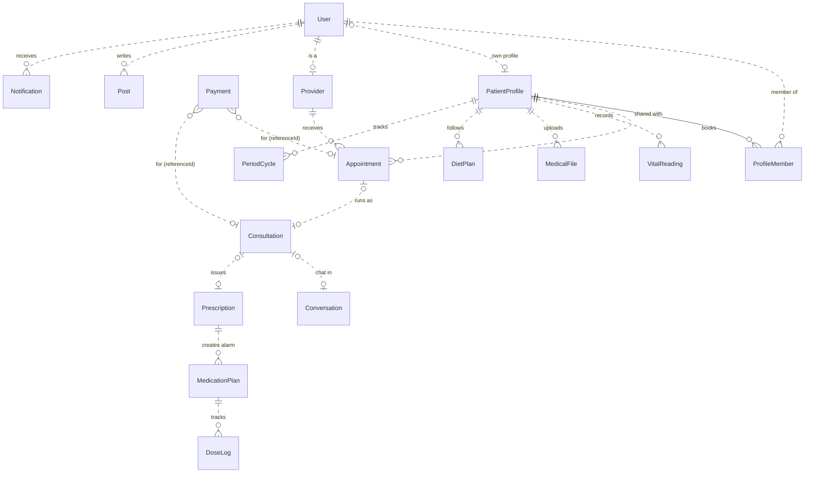

## অথ ও ইউজার

- Module: `modules/auth, modules/users`
- Schema: `auth, users`

লগইন হয় **ইমেইল আর ৬ সংখ্যার পিন** দিয়ে, সাথে ইমেইলে OTP, ডিভাইস আর সেশন। সাইনআপ, ইমেইল-কোডে লগইন আর পিন রিসেট, তিনটাতেই কোড যায় ইমেইলে (nodemailer, SMTP)। ফোন নম্বর আর SMS OTP পরে চালু হবে, তখন `phone` (E.164, শুধু বাংলাদেশি `+8801XXXXXXXXX`) যাচাই করে যোগ হবে। তাই এখন `email` আর `phone` দুটোই nullable ও unique। Guest ইউজারের ইমেইল, ফোন বা পিন কিছুই থাকে না, এটা DB-তে CHECK দিয়ে বাঁধা।

- ইমেইল সবসময় lowercase করে রাখা হয় (DB-তে CHECK), যাতে একই ঠিকানায় দুটো অ্যাকাউন্ট না হয়।
- OTP কোড প্লেইন টেক্সটে থাকে না, থাকে HMAC-SHA256 হিসেবে। একই ঠিকানায় এক মিনিটে একটা আর ঘণ্টায় পাঁচটা কোড যায়, আর প্রতিটা কোডে পাঁচবার ভুল চেষ্টা করা যায়। নতুন কোড গেলে আগেরটা আর কাজ করে না।
- কোড যাচাই হলে একবার ব্যবহারযোগ্য একটা verification token আসে। সেটা খরচ হলে `OtpCode.consumedAt` বসে।
- পিন পরপর পাঁচবার ভুল হলে পিন-লগইন ১৫ মিনিট বন্ধ থাকে (`pinLockedUntil`), আর প্রতি পরের পাঁচ ভুলে সময় দ্বিগুণ হয় (সর্বোচ্চ ২৪ ঘণ্টা)। ইমেইল-কোডে লগইন করলে লক খুলে যায়।
- Refresh token প্রতিবার বদলায়। পুরনো token আবার এলে পুরো সেশন বাতিল হয়।
- একটা অ্যাপ ইনস্টলে (`Device.installationId`) একবারে একটা অ্যাকাউন্টই থাকে। অন্য কেউ লগইন করলে আগের জনের সেশন বাতিল হয় আর তার push token মুছে যায়।

সব স্বাস্থ্য ডেটা যুক্ত থাকে PatientProfile-এর সাথে, User-এর সাথে না। কোন User কোন প্রোফাইল দেখতে বা চালাতে পারবে, সেটা ঠিক হয় **ProfileMember** দিয়ে। এতে দুই ভাইবোন একই বাবার প্রোফাইল একসাথে চালাতে পারে।

- বাবা বা মায়ের নিজের অ্যাপ অ্যাকাউন্ট থাকলে সেটা `linkedUserId` দিয়ে প্রোফাইলের সাথে লিংক হয়। নিজে প্রোফাইল বানালে (`relation = SELF`) অথবা `relation = SELF` আমন্ত্রণ গ্রহণ করলে লিংক হয়। একটা User-এর নিজের প্রোফাইল একটাই।
- নতুন caregiver যোগ হয় ProfileInvite দিয়ে। আমন্ত্রিত ব্যক্তির ইমেইলে খবর যায়। ওই ইমেইল দিয়ে লগইন করে (যেটা সাইনআপের সময় OTP দিয়ে যাচাই করা) অ্যাপ থেকে গ্রহণ করতে হয়, তাই আলাদা কোড লাগে না। আমন্ত্রণ ৭ দিন থাকে। একই প্রোফাইলে একই ইমেইলে একসাথে একটাই PENDING আমন্ত্রণ থাকতে পারে (partial unique index)।
- `relation` রাখা থাকে ProfileMember-এ, কারণ একই মানুষ একজনের বাবা আর আরেকজনের শ্বশুর হতে পারেন। `relation` মানে "এই প্রোফাইলের রোগী আমার কে"।
- একটা প্রোফাইলে কমপক্ষে একজন OWNER থাকতেই হবে। এটা service-এ প্রোফাইলের row lock (`SELECT ... FOR UPDATE`) নিয়ে চেক হয়।
- uuid শুধু ভেতরের key, মানুষকে দেখানো হয় না। দেখানো হয় `patientCode`, যেমন `PR-2611-0042`: অ্যাপে, QR হেলথ কার্ডে আর ডাক্তারের কাছে।
  - `P` = রোগী (ডাক্তার `D`, পুষ্টিবিদ `N`, ফিজিও `T`, মডারেটর `M`, অ্যাডমিন `A`), `R` = নামের প্রথম অক্ষর ইংরেজিতে (বাংলা নাম থেকেও: "রহিম" → R; "ডা.", "মো.", "Md." বাদ), `2611` = তৈরির বছর-মাস (ঢাকার সময়), `0042` = ওই মাসে ওই ধরনের কততম।
  - নম্বর আসে `core.ReadableIdCounter` থেকে: আগের শেষ নম্বর + ১, একটাই atomic SQL-এ, তাই একসাথে দুজন সাইনআপ করলেও একই নম্বর পায় না।
  - ID কখনো বদলায় না (নাম বদলালেও না), আর মুছে যাওয়া প্রোফাইলের নম্বর আর কেউ পায় না। ফরম্যাট DB-তে CHECK দিয়ে বাঁধা।
- প্রোফাইল ডিলিট হয় soft delete (`deletedAt`), কারণ অন্য মডিউলের সারিগুলো এই id ধরে রাখে। ডিলিট হলে `linkedUserId` খালি হয় আর PENDING আমন্ত্রণ বাতিল হয়।

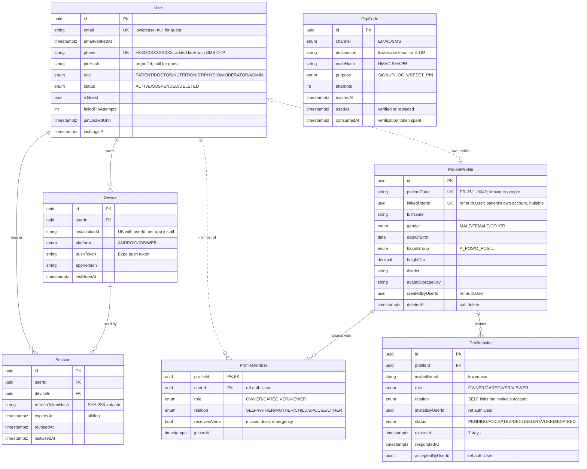

Role permissions:

| Role | স্বাস্থ্য ডেটা দেখা | ডেটা যোগ ও বদলানো | মেম্বার যোগ ও বাদ | প্রোফাইল ডিলিট |
|---|---|---|---|---|
| OWNER | ✓ | ✓ | ✓ | ✓ |
| CAREGIVER | ✓ | ✓ | — | — |
| VIEWER | ✓ | — | — | — |

নারীস্বাস্থ্যের ডেটা শুধু সেই প্রোফাইলের `linkedUserId` দেখতে পারে, অথবা ওই প্রোফাইলের OWNER, যদি প্রোফাইলের নিজের অ্যাকাউন্ট না থাকে। CAREGIVER বা VIEWER এই ডেটা দেখতে পারে না।

## স্বাস্থ্য প্রোফাইল ও রেকর্ড

- Module: `modules/health-profile, modules/records`
- Schema: `health, records`

এই অংশে আছে ভাইটালস (রক্তচাপ, শর্করা, ওজন), দীর্ঘমেয়াদি রোগ ও অ্যালার্জি, QR হেলথ কার্ড, আর ল্যাব রিপোর্ট বা প্রেসক্রিপশনের ফাইল।

- ফাইল থাকে প্রাইভেট স্টোরেজে (প্রাইভেট বাকেট: এখন Cloudflare R2, চাইলে AWS S3)। ডাক্তারের সাথে শেয়ার হয় মেয়াদসহ।
- ভাইটালের সংখ্যাগুলো এনক্রিপ্ট করা হয় না, কারণ ট্রেন্ড চার্ট আর status ফিল্টার SQL-এ চলে।
- রোগের নাম, নোট আর ফাইলের টাইটেল এনক্রিপ্ট করা হয়।
- `status` API নিজে হিসাব করে (`vital-status.ts`)। ওজনের status আসে BMI থেকে (WHO-র এশিয়ান মান), তাই প্রোফাইলে উচ্চতা না থাকলে `status` খালি (null) থাকে।
- DB-তে CHECK: BP হলে শুধু `systolic`/`diastolic` (systolic > diastolic), বাকি সব type-এ শুধু `value`। `context` থাকে শুধু GLUCOSE-এ।
- ছবি WebP হিসেবে রাখা হয়, সাথে 200px আর 800px thumbnail (`private/thumbs/<width>/<yyyy>/<mm>/<uuid>.webp`)। PDF যেমন আছে তেমন থাকে। `mimeType` শুধু `image/webp` বা `application/pdf` (CHECK)। ফাইল ডিলিট হলে স্টোরেজ থেকে ফাইল মুছে যায়, সারিটা `deletedAt` দিয়ে audit-এর জন্য থাকে।
- QR কোডে থাকে শুধু একটা র‍্যান্ডম `qrToken`। স্ক্যান করলে লগইন ছাড়াই জরুরি সারসংক্ষেপ দেখা যায় (নাম, বয়স, রক্তের গ্রুপ, রোগ, অ্যালার্জি, সার্জারি; নোট না), আর প্রতিটা স্ক্যান HealthCardAccess-এ লেখা হয়। নতুন কার্ড দিলে পুরনো QR আর কাজ করে না।
- MedicalFileShare-এর route আসবে doctors + appointments মডিউলের সাথে।

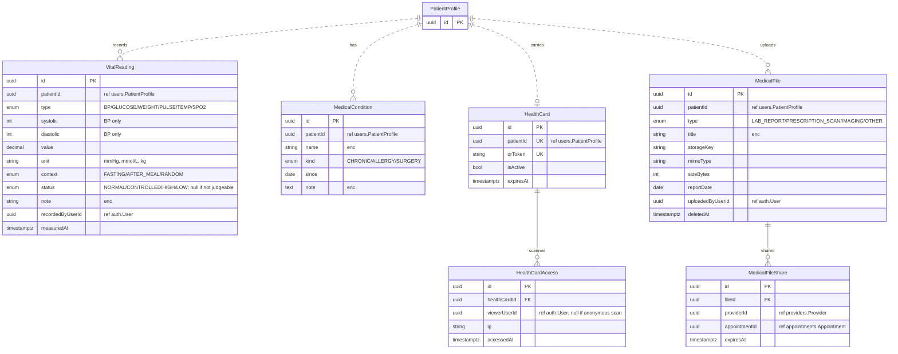

## ডাক্তার ও সেবাদাতা

- Module: `modules/doctors`
- Schema: `providers`

ডাক্তার, পুষ্টিবিদ আর ফিজিওথেরাপিস্ট সবাই একই Provider টেবিলে থাকেন, `type` দিয়ে আলাদা করা হয়।

- প্রত্যেকের একটা readable ID থাকে, `providerCode`, যেমন `DM-2611-0007` (D ডাক্তার, N পুষ্টিবিদ, T ফিজিও)। নিয়ম রোগীর `patientCode`-এর মতোই।
- BMDC নম্বর ইউনিক। শুধু ডাক্তারদের থাকে, ফরম্যাট `A-12345` (দাঁতের ডাক্তার `D-1234`), DB-তে CHECK দিয়ে বাঁধা। অ্যাডমিন BMDC সনদ আর ডকুমেন্ট দেখে VERIFIED করেন। রোগীরা শুধু VERIFIED সেবাদাতা দেখেন।
- অ্যাডমিন বাতিল করলে `rejectionReason` থাকে। সেবাদাতা ঠিক করে আবার পাঠান। VERIFIED ডাক্তার BMDC নম্বর বদলালে আবার PENDING হয়।
- `gender` রাখা হয়েছে যাতে নারী ডাক্তার দিয়ে ফিল্টার করা যায়। ৳১০-এর নারীস্বাস্থ্য কনসাল্ট শুধু নারী ডাক্তারের কাছে যায়।
- ফি: চেম্বারের ফি Chamber-এ (ফলো-আপের কম ফি `followUpFee`)। ভিডিও, চ্যাট আর হোম ভিজিটের ফি Provider-এ। কোনো মোডের ফি না থাকলে সেই মোড বুক করা যায় না।
- Chamber মানে ডাক্তার কোন হাসপাতালে বসেন। Hospital সবার জন্য একটাই তালিকা (নাম + জেলা ইউনিক)।
- চেম্বারে সময় না দিয়ে সিরিয়াল দেওয়া হয়, তাই IN_PERSON Schedule-এ `maxPatients` থাকে। ভিডিও, চ্যাট আর হোম ভিজিটে `slotMinutes` ধরে আলাদা সময়ের স্লট থাকে। দুটোই DB-তে CHECK দিয়ে বাঁধা।
- একই দিনে একজন সেবাদাতার দুটো সেশনের সময় মিলে যেতে পারে না (চেম্বার আর ভিডিও মিলিয়েই)।
- Schedule বা Chamber "মুছে ফেলা" মানে `isActive = false`। আগের বুকিংগুলো থেকে যায়, শুধু নতুন বুকিং বন্ধ হয়।
- ScheduleException: `scheduleId` খালি থাকলে পুরো দিন ছুটি, থাকলে শুধু ওই সেশন বন্ধ বা সময় বদল। `note` রোগী দেখতে পান।
- রেটিং (`ratingAvg`, `ratingCount`) শুধু আসল Review থেকে হিসাব হয়, Review যোগ হওয়ার একই transaction-এ।

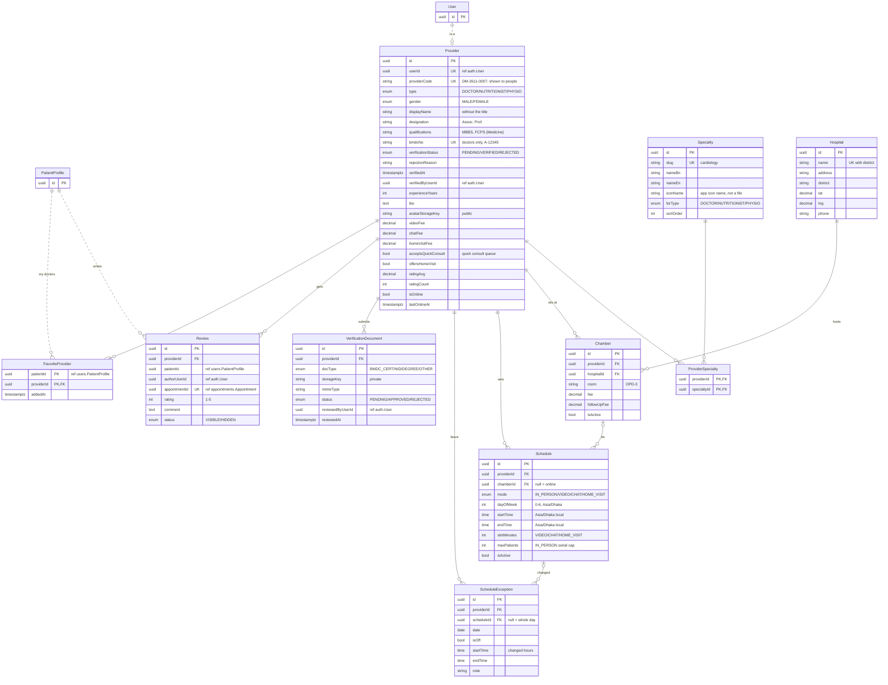

## অ্যাপয়েন্টমেন্ট ও ফলো-আপ

- Module: `modules/appointments`
- Schema: `appointments`

চেম্বার, ভিডিও, চ্যাট আর হোম ভিজিট, চারটাই একটা Appointment টেবিলে থাকে, `mode` দিয়ে আলাদা করা হয়।

- প্রতিটা বুকিংয়ের readable কোড থাকে, যেমন `BK-2611-0042`। চেম্বারের ডেস্কে আর সাপোর্টে এটাই বলা হয়। মানুষের ID-র সাথে গুলিয়ে যায় না, কারণ `B` কোনো মানুষের prefix না।
- বুকিং খোলা থাকে আজ থেকে ৩০ দিন পর্যন্ত। চেম্বারের সিরিয়াল সেশন শেষ হওয়ার ৩০ মিনিট আগে বন্ধ হয়। সময়ের স্লট শুরু হওয়ার ১৫ মিনিট আগে বন্ধ হয়।
- সিরিয়াল দেওয়া হয় সবচেয়ে ছোট খালি নম্বর থেকে, তাই বাতিল হওয়া সিরিয়াল আবার কেউ পায়।
- `sessionEndAt`: চেম্বারে সেশন কখন শেষ, অনলাইনে স্লট কখন শেষ। IN_PERSON-এ প্রতিটা সিরিয়ালের আনুমানিক সময় = সেশন শুরু + (সিরিয়াল − ১) × `durationMin`।
- ফলো-আপ হলো আগের COMPLETED অ্যাপয়েন্টমেন্টের সাথে যুক্ত একটা নতুন অ্যাপয়েন্টমেন্ট (`kind = FOLLOW_UP`), একই ডাক্তার আর একই রোগী। চেম্বারে `followUpFee` থাকলে সেটাই লাগে।
- রোগী বা পরিবার বাতিল করতে পারে: পেমেন্টের অপেক্ষায় থাকলে যেকোনো সময়, CONFIRMED হলে ২ ঘণ্টা আগে পর্যন্ত। ডাক্তার কারণ লিখে বাতিল করলে রোগী push আর SMS পায়। কে বাতিল করল তা `cancelledBy`-তে থাকে। পেমেন্ট ফেরত step 6-এ (`appointment.cancelled` event)।
- ডাক্তার ভিজিট শেষ করার সময় "১৪ দিন পর আসবেন" দিলে FollowUpReminder তৈরি হয়, আর ডাক্তার রোগীর "আমার ডাক্তার"-এ যোগ হন। ডাক্তারের দেওয়া ফলো-আপ রোগী শুধু DONE বা CANCELLED করতে পারে।
- অ্যাপের বাইরের কোনো ডাক্তারের ফলো-আপ ইউজার নিজে যোগ করলে সেটাও FollowUpReminder-এ যায় (`appointmentId` খালি)।
- রিমাইন্ডার: CONFIRMED অ্যাপয়েন্টমেন্ট আর UPCOMING ফলো-আপের জন্য ২৪ ঘণ্টা আর ২ ঘণ্টা আগে (notifications মডিউলের APPOINTMENT ও FOLLOW_UP reminder)। প্রথমটা push, অ্যাপয়েন্টমেন্টের শেষটায় SMS-ও যায়। যিনি বুক করেছেন আর রোগীর নিজের অ্যাকাউন্ট থাকলে তিনি, দুজনেই পান। লেখায় ভিজিটের কারণ বা কোনো স্বাস্থ্য তথ্য থাকে না।

**পেমেন্টের লিংক:** Appointment-এ paymentId নেই। কোন অ্যাপয়েন্টমেন্টের পেমেন্ট, তা পাওয়া যায় `Payment(purpose = APPOINTMENT, referenceId = appointment.id)` থেকে। পেমেন্ট সফল হলে `payment.succeeded` event আসে আর Appointment CONFIRMED হয়। ফি শূন্য হলে বুকিং সাথে সাথে CONFIRMED হয়। development আর staging-এ `POST /payments/:id/dev-simulate-success` gateway ছাড়াই আসল সফল-পথটা চালায় (production-এ 403)।

**স্লট হোল্ড:** বুকিং হলেই Appointment `PENDING_PAYMENT` অবস্থায় যায়, আর `holdExpiresAt` বসে এখন থেকে ১০ মিনিট পরে। একই সাথে একটা BullMQ delayed job যোগ হয়, আর প্রতি ২ মিনিটে একটা sweep হারিয়ে যাওয়া job ধরে। সময়ের মধ্যে পেমেন্ট না এলে status হয় `EXPIRED` আর স্লট আবার খুলে যায়। মেয়াদ শেষের পর পেমেন্ট এলে স্লট খালি থাকলে বুকিং ফিরে আসে, না থাকলে refund লাগে (`appointment.cancelled`, `wasConfirmed = true`)।

**Double booking ঠেকানো** (তিনটাই partial unique index, migration-এ raw SQL হিসেবে):
- IN_PERSON, সিরিয়াল ভিত্তিক: `UNIQUE (scheduleId, sessionDate, serialNo) WHERE mode = 'IN_PERSON' AND status NOT IN ('CANCELLED','EXPIRED')`। সিরিয়াল `maxPatients` ছাড়াতে পারে না।
- VIDEO, CHAT আর HOME_VISIT, সময় ভিত্তিক: `UNIQUE (providerId, scheduledAt) WHERE mode <> 'IN_PERSON' AND status NOT IN ('CANCELLED','EXPIRED')`।
- একজন রোগী একই সেশনে একটাই চালু বুকিং রাখতে পারে: `UNIQUE (patientId, scheduleId, sessionDate) WHERE status NOT IN ('CANCELLED','EXPIRED')`।
- বুকিং transaction-এর শুরুতে `pg_advisory_xact_lock` নেওয়া হয় (সেবাদাতা + দিন), তাই একসাথে আসা বুকিং একটার পর একটা হয়। Schedule টেবিল doctors মডিউলের, তাই সেটা `SELECT ... FOR UPDATE` দিয়ে lock করা হয় না।

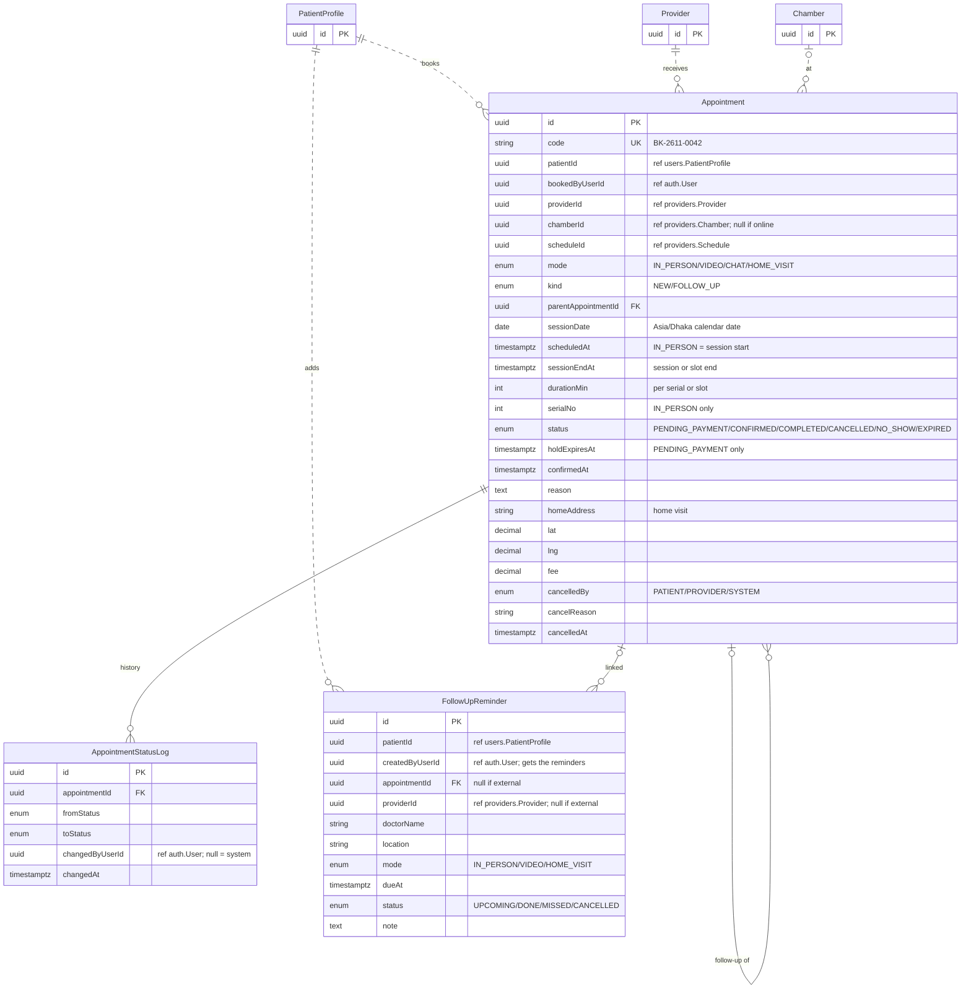

## পরামর্শ ও বার্তা

- Module: `modules/consultation, modules/chat`
- Schema: `consultation, chat`

এই অংশে আছে বুক করা ভিডিও/চ্যাট অ্যাপয়েন্টমেন্টের সেশন (`STANDARD`) আর টাকা দিয়ে অপেক্ষার দ্রুত চ্যাট পরামর্শ (`QUICK`)।

- **দ্রুত পরামর্শের দাম অ্যাডমিন ঠিক করেন** (মালিকের সিদ্ধান্ত, ২০২৬-১১-১১)। প্রতিটা ধরনের (`GENERAL`, `WOMENS_HEALTH`) জন্য `QuickConsultSetting`-এ দাম, চালু/বন্ধ, ডাক্তারের জন্য সর্বোচ্চ অপেক্ষা আর চ্যাটের সময়। শুরুর দাম ৳১০। প্রতিটা বদল `QuickConsultSettingChange`-এ থাকে (কে, কখন, আগে-পরে)।
- পরামর্শ তৈরির সময় দামটা `Consultation.fee`-তে কপি হয়, তাই পরে দাম বদলালে আগের পরামর্শের টাকা বদলায় না।
- **দ্রুত পরামর্শ শুধু চ্যাটে হয়।** DB-তে বাঁধা: `CHECK (tier <> 'QUICK' OR channel = 'CHAT')`। ধরনের নাম `QUICK_10` থেকে `QUICK` করা হয়েছে, কারণ দাম আর ১০ টাকায় বাঁধা নয়।
- দ্রুত পরামর্শের ধাপ: `PENDING_PAYMENT` (১৫ মিনিটে না দিলে `EXPIRED`) → পেমেন্ট হলে `WAITING` (কিউতে) → প্রথম যে ডাক্তার নেন → `ONGOING` (`sessionMin` মিনিট) → `ENDED`। `maxWaitMin`-এর মধ্যে কেউ না নিলে `MISSED` আর পুরো টাকা ফেরত। অপেক্ষার সময় রোগী বাতিল করলেও পুরো টাকা ফেরত।
- একজন রোগীর একসাথে একটাই চালু দ্রুত পরামর্শ: `UNIQUE (patientId) WHERE tier = 'QUICK' AND status IN ('PENDING_PAYMENT','WAITING','ONGOING')`।
- কিউ পান শুধু যাচাই করা, অনলাইন আর `acceptsQuickConsult = true` ডাক্তার। নারীস্বাস্থ্যের কিউতে `requiredProviderGender = FEMALE`, তাই শুধু নারী ডাক্তার। নেওয়ার আগে ডাক্তার শুধু বয়স আর লিঙ্গ দেখেন, নাম বা প্রশ্ন না।
- দুজন ডাক্তার একসাথে নিতে চাইলে `UPDATE … WHERE status = 'WAITING'` যিনি আগে করেন তিনি পান, অন্যজন `QUICK_CONSULT_TAKEN`।
- নারীস্বাস্থ্যের দ্রুত পরামর্শ শুরু করতে পারেন শুধু রোগী নিজে (অ্যাকাউন্ট না থাকলে OWNER), আর এর নোটিফিকেশনে কোনো বিস্তারিত থাকে না।
- পেমেন্ট: `Payment(purpose = QUICK_CONSULT, referenceId = consultation.id)`। পেমেন্টের সময় ডাক্তার জানা থাকে না; ডাক্তার নিলে `payment.provider-assigned` event-এ ডাক্তারের আয় লেখা হয়। ফেরতের জন্য `payment.refund-requested` event।
- বুক করা পরামর্শ: ভিডিও বা চ্যাট অ্যাপয়েন্টমেন্ট CONFIRMED থাকলে ডাক্তার নির্ধারিত সময়ের ১৫ মিনিট আগে থেকে শেষ সময়ের ১ ঘণ্টা পর পর্যন্ত শুরু করতে পারেন (`appointmentId` UNIQUE, তাই একটাই)। বুকিং বাতিল হলে চলমান পরামর্শ শেষ হয়।
- প্রতিটা পরামর্শের একটা চ্যাট থাকে। কে দেখতে পারবেন তা চ্যাটের সদস্য দিয়ে ঠিক হয়: ডাক্তার, যিনি বুক/শুরু করেছেন, আর বুক করা পরামর্শে রোগীর নিজের অ্যাকাউন্ট।
- **ভিডিও কল (Agora):** ডাক্তার কলে ঢুকলে `rtcChannel` তৈরি হয়, `callActive = true` হয় আর রোগীর ফোনে রিং যায় (Socket.io আর push)। রোগী শুধু ডাক্তার কলে থাকলেই ঢুকতে পারেন। টোকেন API দেয়, App Certificate শুধু সার্ভারে। Agora uid: ডাক্তার ১০০১, রোগী ২০০১।
- চ্যাট মেসেজ REST দিয়ে পাঠানো হয় (`clientMsgId` দিয়ে একই মেসেজ দুবার হয় না), আর অন্য পক্ষে যায় Socket.io দিয়ে। কেউ অ্যাপ খোলা না রাখলে লেখা ছাড়া শুধু "নতুন বার্তা" push যায় (২ মিনিটে একবার)। পরামর্শ শেষ হলে চ্যাট শুধু পড়া যায়।
- Socket.io-তে ঢোকা হয় এককালীন টিকিট দিয়ে (`POST /realtime/ticket`, ৬০ সেকেন্ড, Redis-এ)। প্যানেলের টোকেন httpOnly কুকিতে থাকে বলে এই ব্যবস্থা।
- মেসেজের body আর attachment এনক্রিপ্ট করা। ছবি upload pipeline দিয়ে প্রাইভেট স্টোরেজে যায়।

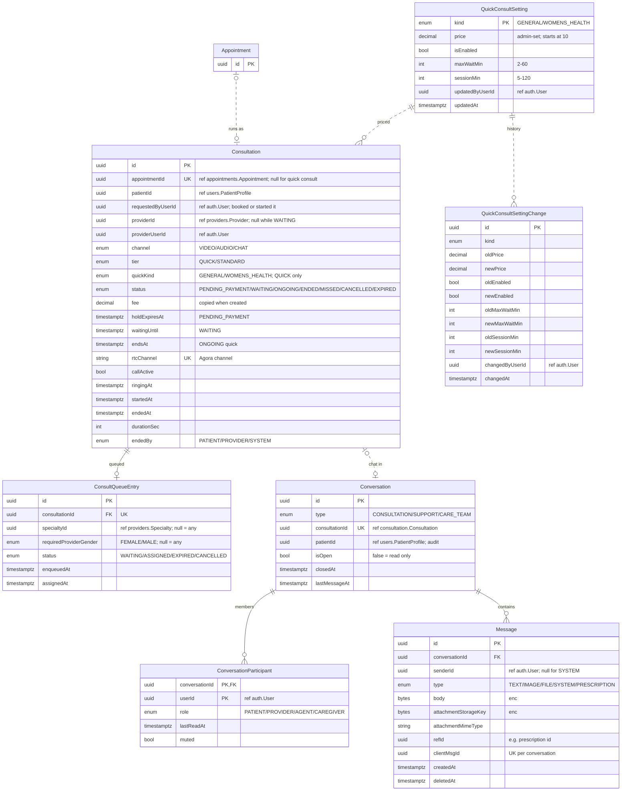

CHECK (migration-এ): দ্রুত পরামর্শ শুধু চ্যাট; STANDARD হলে `appointmentId` আছে; QUICK হলে `quickKind` আছে; ফি ≥ ০; ডাক্তার ছাড়া শুধু PENDING_PAYMENT/WAITING/MISSED/CANCELLED/EXPIRED; দাম ০-এর বেশি আর ≤ ৫,০০০; মেসেজে body বা attachment আছে; SYSTEM ছাড়া senderId আছে।

## ডিজিটাল প্রেসক্রিপশন

- Module: `modules/prescriptions`
- Schema: `prescriptions`

ডাক্তার একটা ভিজিট (অ্যাপয়েন্টমেন্ট) বা পরামর্শের জন্য প্রেসক্রিপশন লেখেন। প্রতিটা ওষুধ একটা PrescriptionItem।

- **ধাপ:** `DRAFT` (যতবার খুশি বদলানো যায়) → `ISSUED` (আর বদলায় না) → দরকার হলে কারণসহ `REVOKED`, তারপর নতুন লেখা। একটা ভিজিট বা পরামর্শে একসাথে একটাই খোলা (খসড়া বা দেওয়া) প্রেসক্রিপশন থাকে (partial unique index)।
- নম্বর `RX-2611-0042` (readable-ID counter, kind `PRESCRIPTION`)।
- লেখেন শুধু যাচাই করা ডাক্তার (`Provider.type = DOCTOR`), নিজের CONFIRMED (সময়ের ১ ঘণ্টা আগে থেকে) বা COMPLETED অ্যাপয়েন্টমেন্টের জন্য, অথবা নিজের ONGOING/ENDED পরামর্শের জন্য।
- দেওয়া হলে রোগীর পরিবার (যিনি বুক/শুরু করেছেন আর রোগীর নিজের অ্যাকাউন্ট) নোটিফিকেশন পান, আর পরামর্শের চ্যাটে একটা প্রেসক্রিপশন কার্ড যায় (`Message.type = PRESCRIPTION`, `refId`)।
- পরিবার শুধু ISSUED আর REVOKED দেখে, খসড়া কখনো না। নারীস্বাস্থ্যের পরামর্শ থেকে আসা প্রেসক্রিপশন (`isSensitive`) শুধু রোগী নিজে দেখেন (অ্যাকাউন্ট না থাকলে OWNER)।
- **এক চাপে অ্যালার্ম:** `dosePattern` (যেমন `1+0+½`, `১+০+১`, `1+1+1+1`) ভেঙে প্রতিটা সময়ের জন্য আলাদা ডোজসহ MedicationTime তৈরি হয়। ১টা অংশ = সকাল ৮টা; ২টা = ৮টা আর রাত ৯টা; ৩টা = ৮টা, দুপুর ২টা, রাত ৯টা; ৪টা = ৮টা, ১টা, সন্ধ্যা ৬টা, রাত ১০টা। ০ ডোজের সময় বাদ যায়। `durationDays` থেকে শেষ তারিখ; খালি হলে চলবে। পরে রোগী সময় বদলাতে পারেন। প্ল্যান `MedicationPlan.prescriptionItemId` দিয়ে লাইনটাকে চেনে; একই লাইন থেকে চালু অ্যালার্ম দুবার হয় না।
- টেস্টের রিপোর্ট আপলোড হলে রোগী সেটা PrescribedTest-এর সাথে যুক্ত করেন (`resultFileId`, একই প্রোফাইলের ফাইল হতে হবে)।
- ওষুধের ধরন, ডোজের একক আর খাবারের সময় মেডিসিন মডিউলের একই মান ব্যবহার করে।
- `pdfStorageKey` রাখা আছে, কিন্তু এখন PDF সার্ভারে তৈরি হয় না: প্যানেল থেকে প্রিন্ট বা "Save as PDF" করা হয় (ব্রাউজারে বাংলা যুক্তাক্ষর ঠিক থাকে)।

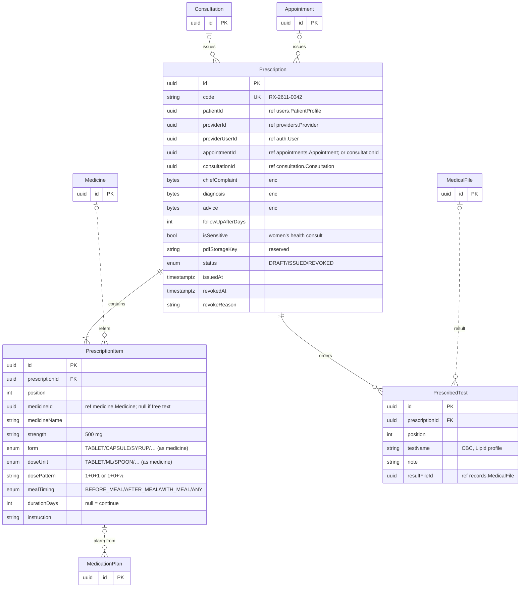

CHECK (migration-এ): কোড `RX-` ফরম্যাট; ঠিক একটা উৎস (অ্যাপয়েন্টমেন্ট বা পরামর্শ); DRAFT ছাড়া `issuedAt` আছে; REVOKED হলেই `revokedAt`; ফলো-আপ ১–৩৬৫ দিন; ওষুধের দিন ১–৩৬৫।

## মেডিসিন অ্যালার্ম

- Module: `modules/medicine`
- Schema: `medicine`

প্রতিটা ওষুধের জন্য একটা MedicationPlan থাকে। দিনে কখন আর কতটা খাবে, তা থাকে MedicationTime-এ।

- ডোজের পরিমাণ রাখা হয়েছে MedicationTime-এ, কারণ `1+0+½`-এর মতো প্যাটার্নে সকাল আর রাতের ডোজ আলাদা।
- প্রতিটা নির্ধারিত ডোজের জন্য একটা DoseLog তৈরি হয়। ‘৩টির মধ্যে ২টি নেওয়া হয়েছে’ আর সঠিক সময়ে সেবনের হার সেখান থেকেই আসে।
- `stockQty` decimal, কারণ আধা ট্যাবলেটও খাওয়া হয়। TAKEN হলে stock থেকে ডোজ বাদ যায়। বাকি stock দিয়ে কত দিন চলবে, সেটা `refillAlertDays`-এর সমান বা কম হলে রিফিল অ্যালার্ট যায়।

**অ্যালার্ম কীভাবে বাজে:**
- ডোজের অ্যালার্ম শুধু ফোনে বাজে, লোকাল `expo-notifications` দিয়ে, যাতে অফলাইনেও কাজ করে।
- সার্ভার ডোজের জন্য push পাঠায় না।
- সার্ভার শুধু একটা `DOSE_BACKUP` রিমাইন্ডার রাখে। নির্ধারিত সময়ের X মিনিট পরেও DoseLog TAKEN বা SKIPPED না হলে রোগীকে SMS যায়। একই সাথে `receivesAlerts` চালু থাকা caregiver-দের কাছে push যায়।

**ডোজ কীভাবে তৈরি ও হিসাব হয়:**
- সার্ভার প্রতি ৩০ মিনিটে চালু থাকা প্ল্যানের পরের ৩৬ ঘণ্টার ডোজ (PENDING DoseLog) আর প্রতিটার `DOSE_BACKUP` আগে থেকে বানিয়ে রাখে। প্ল্যান যোগ বা বদলালে সাথে সাথেই বানায়। `(planId, scheduledFor)` unique, তাই একই ডোজ দুবার হয় না।
- অ্যাপ ডোজ চিহ্নিত করে প্ল্যান আর সময় দিয়ে (DoseLog id লাগে না)। তাই অফলাইনে "সেবন করেছি" চাপলে নেট এলে পরে পাঠানো যায়। PENDING পাঠালে আগের চিহ্ন বাতিল (ভুল চাপলে undo), আর TAKEN বাতিল হলে stock ফেরত যায়।
- Snooze করলে backup সরে যায়: ডোজের সময় আর snooze শেষ, এর যেটা পরে, তার X মিনিট পর।
- কেউ ৬ ঘণ্টায় কিছু না করলে ডোজ MISSED হয়। সেবনের হার = যে ডোজগুলোর সময় পেরিয়েছে তার মধ্যে TAKEN কয়টা। সময়ের ১ ঘণ্টার মধ্যে নিলে "সময়মতো"।
- প্ল্যান যোগ করার আগের সময়ের ডোজ হিসাবে আসে না (বিকেল ৩টায় যোগ করলে সকাল ৮টার ডোজ বাকি দেখায় না)।
- প্ল্যান বন্ধ (stop) করলে `isActive = false` আর `stoppedAt` বসে। আগের ইতিহাস থাকে, ভবিষ্যতের ডোজ আর backup মুছে যায়। ভুল করে যোগ হলে delete করা যায় (ইতিহাসসহ)।
- রিফিল অ্যালার্ট: stock `refillAlertDays` দিনের বা কম থাকলে, দিনে সর্বোচ্চ একবার, যতক্ষণ না stock বাড়ানো হয়।
- প্রোফাইল ডিলিট হলে তার সব প্ল্যান বন্ধ হয় আর রিমাইন্ডার বাতিল হয়।
- ওষুধ খোঁজা (`Medicine`) ব্র্যান্ড বা জেনেরিক নামে, বানান ভুল হলেও (pg_trgm GIN index)। ক্যাটালগে না থাকলে রোগী নিজে নাম লিখে যোগ করতে পারে (`medicineId` খালি)।
- `doseUnit` নির্দিষ্ট মানের একটা: TABLET, CAPSULE, ML, SPOON, DROP, PUFF, UNIT, SACHET, APPLICATION (অ্যাপ বাংলায় দেখায়)।
- DB-তে CHECK: dose > 0, `daysMask` ১–১২৭, stock ≥ ০, `endDate ≥ startDate`, `isActive = (stoppedAt IS NULL)`, SNOOZED হলে `snoozedUntil` থাকতেই হবে।

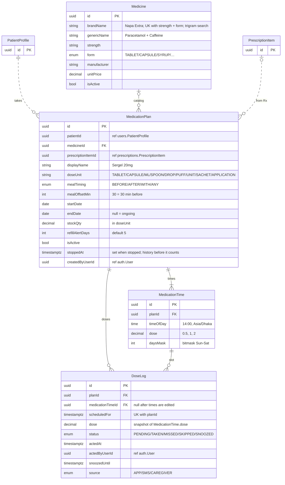

## পুষ্টিবিদ ও ডায়েট চার্ট

- Module: `modules/nutrition`
- Schema: `nutrition`

পুষ্টিবিদ (Provider, `type = NUTRITIONIST`) রোগীর জন্য DietPlan বানান। তাতে থাকে সকাল, দুপুর, বিকাল আর রাতের খাবার। প্রতিদিনের ক্যালরি আর পানির হিসাব থাকে IntakeLog-এ, প্রতি রোগীর প্রতি দিনে একটা সারি।

পেমেন্ট (মালিকের সিদ্ধান্ত, ২০২৬-১১-১৪): পুষ্টিবিদকে বুক করা হয় সাধারণ Appointment দিয়ে (`purpose = APPOINTMENT`)। ভিজিটের পর পুষ্টিবিদ প্যানেল বা অ্যাপের সেবাদাতা অংশ থেকে চার্ট দেন। আলাদা কোনো DietPlan কেনাকাটা নেই।

- এক ভিজিটে একটাই চার্ট: `appointmentId` unique। ভিজিটটা ওই পুষ্টিবিদের আর CONFIRMED বা COMPLETED হতে হবে। চার্ট দেওয়ার তালিকায় গত ৬০ দিনের ভিজিট আসে।
- এক রোগীর একটাই ACTIVE চার্ট: partial unique index `(patientId) WHERE status = 'ACTIVE'`। নতুনটা দিলে আগেরটা ENDED হয়।
- DRAFT শুধু পুষ্টিবিদ দেখেন; DRAFT মোছা যায়। ACTIVE চার্ট সংশোধন করা যায় (খাবারগুলো পুরো বদলে যায়)।
- IntakeLog: আজ আর আগের ৭ দিন বদলানো যায়। `caloriesKcal` = মানা খাবারগুলোর `approxKcal`-এর যোগফল, সার্ভার হিসাব করে।
- খাবারের ছবি নেই (`imageStorageKey` বাদ)। খাবার ১ থেকে ৬টা।

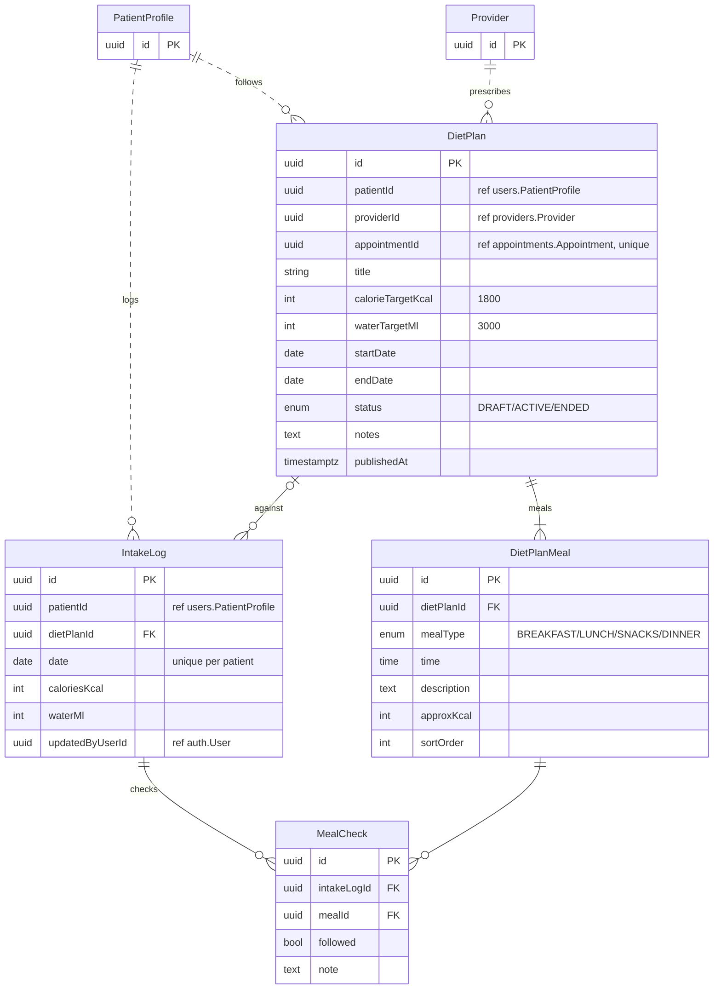

## নারীস্বাস্থ্য ও পিরিয়ড ট্র্যাকার

- Module: `modules/womens-health`
- Schema: `womens_health`

এই অংশে আছে পিরিয়ডের তারিখ, প্রতিদিনের লক্ষণ ও মেজাজ, আর গর্ভধারণ ট্র্যাকিং।

- **অনুমান জমা থাকে না।** পরবর্তী পিরিয়ড, ডিম্বস্ফোটন (পরবর্তী শুরু − ১৪ দিন) আর উর্বর সময় (ডিম্বস্ফোটন − ৫ থেকে + ১ দিন) প্রতিবার service হিসাব করে (`cycle-predictions.ts`), শেষ ২৪টা পিরিয়ড decrypt করে। একজনের ডেটা অল্প, তাই এটা দ্রুত হয়।
  - গড় চক্র = শেষ ৬টা চক্রের গড় (১৫–৬০ দিনের বাইরেরগুলো বাদ, ওগুলো লগ করতে ভুলে যাওয়া)। একটাও না থাকলে `CycleSettings`-এর গড়।
  - চক্রের দৈর্ঘ্য (এক শুরু থেকে পরের শুরু) আর পিরিয়ডের দিন সংখ্যাও হিসাব করা হয়, কলামে রাখা হয় না।
- একই রোগীর দুটো পিরিয়ডের শুরু ১০ দিনের কম দূরে হতে পারে না, একটা পিরিয়ড ১৫ দিনের বেশি হতে পারে না, আর ভবিষ্যতের তারিখ লগ করা যায় না।
- `DailyLog` পুরো দিন একবারে সেভ হয়; সব খালি করে সেভ করলে সারিটাই মুছে যায়।
- একজন রোগীর একসাথে একটাই ACTIVE গর্ভধারণ (partial unique index)। Due date = LMP + ২৮০ দিন; সপ্তাহ আর ত্রৈমাসিক হিসাব করা হয়।
- `gender = MALE` প্রোফাইলে এই অংশ বন্ধ (`WOMENS_HEALTH_NOT_AVAILABLE`)।
- **এনক্রিপশন:** id, patientId, আর query বা unique-এর জন্য লাগে এমন `date`/`startDate` বাদে এই schema-র সব কলাম `enc`।
- **অ্যাপ লক:** `appLockEnabled` শুধু একটা ফ্ল্যাগ। লক PIN সার্ভারে যায় না। সেটা ফোনের `expo-secure-store`-এ থাকে, আর চাইলে বায়োমেট্রিক দিয়েও খোলা যায়।
- এই ডেটা কারা দেখতে পারবে, তা "অথ ও ইউজার" অংশের permission table-এ আছে।

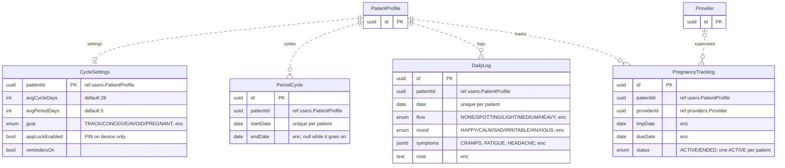

## কমিউনিটি ও ফোরাম

- Module: `modules/community`
- Schema: `community`

দুটো আলাদা জায়গা (মালিকের সিদ্ধান্ত, ২০২৬-১১-১৪):
- **সাধারণ কমিউনিটি (`space = COMMON`):** লগইন করা যে কেউ প্রশ্ন বা উত্তর লিখতে পারেন; অতিথিরা শুধু পড়েন।
- **নারী কমিউনিটি (`space = WOMEN`):** বন্ধ জায়গা।
  - যার নিজের প্রোফাইলে (`PatientProfile.linkedUserId = user.id`) `gender = FEMALE`, তিনি যোগ দেওয়ার অনুরোধ পাঠান (WomenCommunityMember, PENDING)।
  - একজন মডারেটর একবার অনুমোদন দিলে APPROVED হয়।
  - REJECTED হলে আবার অনুরোধ পাঠানো যায়।
  - REMOVED হলে নিজে আর পাঠানো যায় না; মডারেটর চাইলে আবার যোগ করতে পারেন।
  - পড়তে আর লিখতে পারেন শুধু APPROVED সদস্য (এবং মডারেটর/অ্যাডমিন, মডারেশনের জন্য)।
  - এর পোস্ট বাইরের কেউ, আইডি দিয়েও, খুলতে পারেন না।
  - Push-এর লেখায় কোনো বিষয়বস্তু থাকে না।

অন্যান্য নিয়ম:
- পোস্টের `space` ক্যাটাগরি থেকে কপি হয়, তাই প্রতিটা চেকে join লাগে না।
- বেনামী পোস্ট বা উত্তরেও `authorUserId` জমা থাকে মডারেশনের জন্য। অন্যরা দেখেন `anonAlias` ("বেনামী সদস্য ৪৮২১"); মডারেটর রিপোর্টে আসল লেখককে দেখেন।
- যাচাই করা সেবাদাতা নাম দিয়ে লিখলে `providerId` বসে, আর সেটা "যাচাই করা ডাক্তারের উত্তর"। পোস্টে `doctorAnswerCount` রাখা হয়।
- লাইক পোস্ট আর উত্তর দুটোতেই (Reaction, একজনের একটাই)।
- রিপোর্ট: একজন একই জিনিস একবারই রিপোর্ট করতে পারেন (unique)। মডারেটর লুকান, লুকিয়ে ব্যান করেন, অথবা খারিজ করেন; একই জিনিসের সব খোলা রিপোর্ট একসাথে বন্ধ হয়।
- CommunityBan: `ALL` হলে কোথাও লেখা যায় না, `WOMEN` হলে নারী কমিউনিটিতে ঢোকা যায় না।
- ছবি (প্রতি পোস্টে সর্বোচ্চ ৩টি) প্রাইভেট স্টোরেজে, মেয়াদওয়ালা লিংকে দেখা যায়।
- Tag টেবিল আর LOVE/HAHA রিঅ্যাকশন এখন রাখা হয়নি (আগের ডিজাইনে ছিল)।

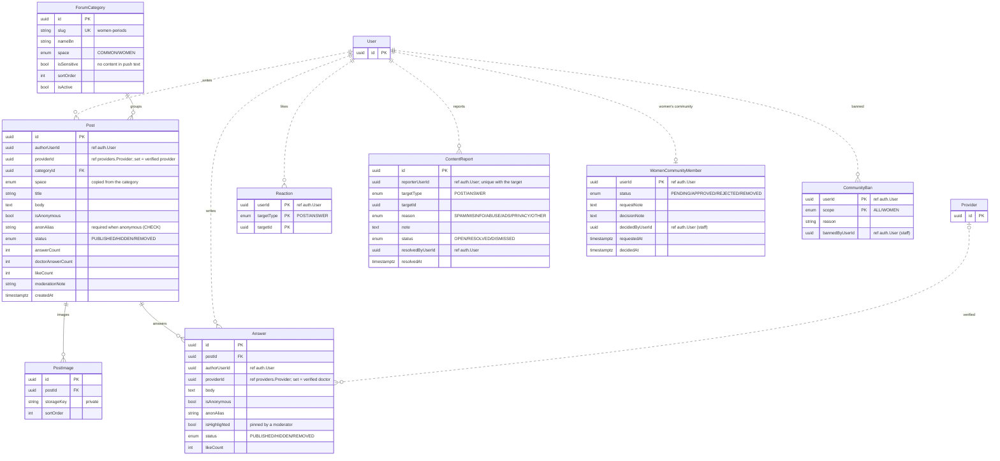

## পেমেন্ট ও পেআউট

- Module: `modules/payments`
- Schema: `payments`

পেমেন্ট আসে একটা **aggregator** দিয়ে: এখন **shurjoPay**, এক সেটিং বদলে **SSLCommerz** (মালিকের সিদ্ধান্ত, ২০২৬-১১-১০)। বিকাশ, নগদ, রকেট আর কার্ড সব ওই gateway-এর পাতাতেই। তাই আলাদা bKash/Nagad integration লাগে না।

- **Gateway বদলানো:** দুটো gateway-ই `PaymentGateway` interface-এর পেছনে (`createCheckout`, `verify`, `refund`, `refundStatus`)। নতুন পেমেন্ট যায় `PAYMENT_GATEWAY` env-এর gateway দিয়ে। যে পেমেন্ট যে gateway-এ হয়েছে, তার যাচাই আর refund সেই gateway দিয়েই হয় (`Payment.gateway`), তাই switch করলে পুরোনো পেমেন্ট আটকে যায় না।
- **রসিদ নম্বর:** `RC-2611-0042`, পেআউট নম্বর `ST-2611-0003` (readable-ID counter, kind `PAYMENT`/`PAYOUT`)। `PY`/`PO` নেওয়া হয়নি, কারণ সেগুলো Y বা O দিয়ে শুরু নামের রোগীর ID-র মতো দেখায়।
- **লিংক কোন দিকে:** Payment কোন জিনিসের জন্য, তা Payment নিজেই ধরে রাখে `purpose + referenceId` দিয়ে। Appointment বা Consultation-এ paymentId নেই। কোন জিনিস কত টাকায় পেমেন্টযোগ্য, তা জানায় সেই জিনিসের মডিউল (`PayableRegistryService`-এ resolver)।
- একটা `referenceId`-এর জন্য একসাথে একটাই সক্রিয় পেমেন্ট থাকতে পারে: `UNIQUE (purpose, referenceId) WHERE status IN ('INITIATED','SUCCESS')`। একই checkout আবার চাইলে আগেরটাই ফেরত আসে (মেয়াদ থাকলে)।
- **পেমেন্ট নিশ্চিত হয় শুধু gateway-এর নিজের API দিয়ে যাচাই করে।** Return URL, IPN, অ্যাপের "check" আর প্রতি ৫ মিনিটের reconciliation job, যেটা আগে আসে। callback শুধু বলে কোন পেমেন্ট দেখতে হবে। টাকার অঙ্ক না মিললে FAILED (`AMOUNT_MISMATCH`)। একাধিকবার এলেও একবারই হিসাব হয়।
- সফল হলে `payment.succeeded` event যায়, আর অ্যাপয়েন্টমেন্ট CONFIRMED হয়। hold শেষ হওয়ার পর পেমেন্ট এলে: স্লট খালি থাকলে বুকিং ফিরে আসে, না থাকলে স্বয়ংক্রিয় refund।
- ৪৫ মিনিটে শেষ না হওয়া checkout বাতিল (`ABANDONED`)। একই জিনিসের জন্য দুবার টাকা কাটলে দ্বিতীয়টা REFUNDED অবস্থায় রেখে refund তৈরি হয়।
- **Refund:** পেমেন্ট করা বুকিং বাতিল হলে (রোগী সময়মতো, ডাক্তার, বা সিস্টেম) পুরো টাকা ফেরত। SSLCommerz-এ refund API দিয়ে নিজে থেকে হয় (পরে status poll)। shurjoPay-এর refund API নেই: অ্যাডমিন মার্চেন্ট প্যানেল থেকে ফেরত দিয়ে প্যানেলে রেফারেন্স লেখেন।
- প্রতিটা সফল পেমেন্ট থেকে ডাক্তারের আয় (ProviderEarning, `kind = EARNING`): `platformFee = amount × PLATFORM_FEE_PERCENT` (এখন ১০%), বাকিটা `net`।
- **Refund সম্পন্ন হলে সবসময়** একটা negative `REFUND_ADJUSTMENT` সারি তৈরি হয়, payout হোক বা না হোক। পরের Payout থেকে কাটা যায়। আগের Payout কখনো বদলানো হয় না।
- **Payout:** অ্যাডমিন একটা দিন পর্যন্ত কার অনিষ্পন্ন আয় কত দেখেন, Payout তৈরি করেন (ওই সারিগুলো `FOR UPDATE` দিয়ে lock করে), টাকা পাঠিয়ে TrxID দিয়ে PAID করেন। PENDING payout বাতিল করলে আয় আবার অনিষ্পন্ন হয়।
- ডাক্তার কোথায় টাকা পাবেন (বিকাশ, নগদ বা ব্যাংক) তা `ProviderPayoutAccount`-এ। নম্বর এনক্রিপ্ট করা; লিস্টে শুধু শেষ ৪ সংখ্যা।
- GatewayTransaction-এ প্রতিটা call-এর অনুরোধ আর উত্তর থাকে। password আর token বাদ দিয়ে।

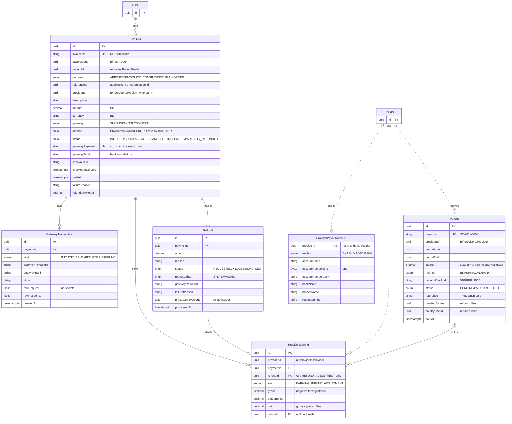

ProviderEarning-এর index:
- `UNIQUE (paymentId) WHERE kind = 'EARNING'`
- `UNIQUE (refundId) WHERE refundId IS NOT NULL`
- CHECK: `net = gross - platformFee`; EARNING ধনাত্মক, REFUND_ADJUSTMENT ঋণাত্মক।

## নোটিফিকেশন ও রিমাইন্ডার

- Module: `modules/notifications`
- Schema: `notifications`

ফলো-আপ, অ্যাপয়েন্টমেন্ট, রিফিল, পিরিয়ড আর ডোজের SMS ব্যাকআপ, সব সার্ভার রিমাইন্ডার এক জায়গায় থাকে।

- ডোজের মূল অ্যালার্ম লোকাল, তাই এখানে থাকে শুধু `DOSE_BACKUP` ("মেডিসিন অ্যালার্ম" অংশ দেখো)।
- ScheduledReminder-এর `jobId` দিয়ে BullMQ-এর কাজ বাতিল বা বদলানো যায়।
- প্রতিটা আসল পাঠানো (Push, SMS, ইন-অ্যাপ) একটা Notification সারি।
- `isSensitive` ক্যাটাগরি আর নারীস্বাস্থ্যের নোটিফিকেশনের লেখায় স্বাস্থ্য তথ্য থাকে না, শুধু থাকে “আপনার একটি রিমাইন্ডার আছে”।
- একই জিনিসের (একই `kind` + `refId`) একসাথে একটাই SCHEDULED রিমাইন্ডার থাকে (partial unique index)। নতুন করে schedule করলে আগেরটা CANCELLED হয়।
- রিমাইন্ডার বাজার মুহূর্তে মালিক মডিউল (যেমন medicine) ঠিক করে কাকে কী পাঠাবে। ততক্ষণে ডোজ নেওয়া হয়ে গেলে কিছু যায় না, রিমাইন্ডার CANCELLED হয়। `userId` মূল প্রাপক; `receivesAlerts` চালু পরিবারের সদস্যরাও পায়।
- Redis চলে গেলেও রিমাইন্ডার হারায় না: প্রতি ১০ মিনিটে দেরি হওয়া বা job ছাড়া SCHEDULED রিমাইন্ডার আবার queue-তে যায়। দুবার পাঠানো ঠেকাতে পাঠানোর আগে সারিটা SENT করে নেওয়া হয়।
- Push যায় Expo push service দিয়ে, শুধু সেই ফোনে যেখানে লগইন আছে। অ্যাপ মুছে ফেললে (`DeviceNotRegistered`) token মুছে যায়।
- SMS gateway এখনো ঠিক হয়নি (CLAUDE.md §3), আর ফোন নম্বরও এখন নেওয়া হয় না। তাই SMS-এর Notification সারি সৎভাবে FAILED থাকে (`NO_PHONE` / `SMS_PROVIDER_NOT_CONFIGURED`)।
- Quiet hours (`quietStart`–`quietEnd`, ঢাকার সময়, মাঝরাত পেরোতে পারে): এ সময়ে push শব্দ ছাড়া আসে। ডোজ মিস হওয়ার সতর্কতা (`urgent`) তবুও শব্দ করে।
- অ্যাপের ঘণ্টা আইকনের তালিকা = `channel = IN_APP` সারিগুলো। প্রতিটা চ্যানেলের চেষ্টা আলাদা সারি; ব্যর্থ হলে `failureReason`-এ কারণের কোড থাকে, বার্তার লেখা কখনো না।

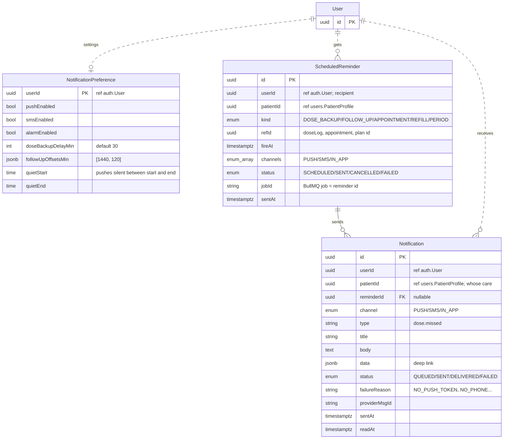

## আকস্মিক সেবা, কনটেন্ট ও অ্যাডমিন

- Module: `modules/emergency, modules/content, modules/admin`
- Schema: `emergency, content, admin`

**আকস্মিক সেবা (`emergency`)**
- হোম স্ক্রিনের ‘আকস্মিক সেবা’ বাটন একটা EmergencyRequest তৈরি করে (`code` = `EM-2611-0007`, counter kind `EMERGENCY`)। প্রোফাইলের যেকোনো সদস্য (VIEWER-ও) চাপতে পারেন।
  - পরিবারকে জানানো হয়: `receivesAlerts` চালু থাকা সদস্য আর রোগীর নিজের অ্যাকাউন্ট (যিনি চেপেছেন তিনি বাদে), push + in-app + SMS, `urgent`।
  - `notifyOnSos` চালু থাকা EmergencyContact-দের SMS যায়। SMS গেটওয়ে এখনো ঠিক হয়নি, তাই এখন এগুলো ব্যর্থ হয় আর `contactsFailed`-এ গোনা হয়; অ্যাপ তখন নিজে ফোন করতে বলে।
  - সব সক্রিয় ADMIN আর MODERATOR push + in-app পান, আর প্যানেলে Socket.io-র `staff` room দিয়ে সাথে সাথে দেখেন।
  - লোকেশন আসে ফোনের GPS থেকে (`expo-location`, শুধু অ্যাপ খোলা থাকলে), না পেলে লেখা ঠিকানা।
- একজন রোগীর একসাথে একটাই OPEN/DISPATCHED অনুরোধ (partial unique index)। আবার চাপলে আগেরটাই ফেরত আসে।
- অবস্থা: OPEN → DISPATCHED (স্টাফ, পরিবারের জন্য বার্তা `handlerNote` সহ) → CLOSED; পরিবার OPEN বা DISPATCHED অবস্থায় CANCELLED করতে পারে। অবস্থা বদলায় `updateMany ... WHERE status IN (...)` দিয়ে, তাই দুজন স্টাফ একসাথে চাপলেও একজনই পারেন।
- স্টাফ অনুরোধের সাথে রোগীর রক্তের গ্রুপ, দীর্ঘমেয়াদি রোগ, অ্যালার্জি আর কন্টাক্ট দেখেন (QR কার্ডের মতো)। প্রতিবার দেখা audit-এ যায় (`emergency.staff.view`)।
- EmergencyContact: প্রতি প্রোফাইলে সর্বোচ্চ ৫ জন, নম্বর শুধু বাংলাদেশি E.164 (DB CHECK), একই নম্বর দুবার না (unique)। দেখতে VIEW, বদলাতে EDIT লাগে।

**স্বাস্থ্য টিপস (`content`)**
- স্টাফ (ADMIN, MODERATOR) প্যানেলে লেখেন: খসড়া → প্রকাশ (আবার খসড়ায় ফেরানো যায়)। প্রকাশিত টিপস সবাই দেখে, অতিথিরাও (public route)।
- লেখক হিসেবে একজন যাচাই করা সেবাদাতার নাম দেওয়া যায় (`authorProviderId`)।
- ছবি public storage-এ WebP, ২০০ আর ৮০০ px thumbnail সহ। আবার প্রকাশ করলে প্রথম `publishedAt` থাকে। `status = PUBLISHED` হলে `publishedAt` থাকতেই হবে (CHECK)।

**অ্যাডমিন (`admin`)**
- অ্যাপের মূল রং অ্যাডমিন প্যানেল থেকে বদলান (AppSetting, একটাই সারি; প্রতিটা বদল AppSettingChange-এ)। অ্যাপ `GET /app-config` থেকে রং আর তার শেড নেয়। সাদা লেখা পড়া যায় না এমন হালকা রং API নেয় না।
- কেউ কারো স্বাস্থ্য ডেটা দেখলে বা বদলালে AuditLog-এ লেখা হয়। প্রতিটা মডিউল `audit.*` event পাঠায়, আর admin মডিউল (`audit.**` listener, async) সেটা লেখে। লেখা ব্যর্থ হলে মূল কাজ ব্যর্থ হয় না।
- স্টাফ: ভূমিকা থাকে `auth.User.role`-এ (MODERATOR/ADMIN), আর StaffMember-এ থাকে মানুষকে দেখানো স্টাফ আইডি (`AS-2611-0001`, `MJ-2611-0001`) আর নাম। স্টাফ থেকে বাদ দিলে ভূমিকা PATIENT হয় কিন্তু সারিটা থাকে, তাই আবার যোগ করলে একই আইডি পান।
  - সেবাদাতার অ্যাকাউন্ট স্টাফ হতে পারে না। নিজের ভূমিকা নিজে বদলানো যায় না, আর অন্তত একজন সক্রিয় ADMIN থাকতেই হয়।
  - কী কে পারে: MODERATOR = জরুরি সেবা আর স্বাস্থ্য টিপস (পরে ফোরাম মডারেশন); ADMIN = সব, সাথে সেবাদাতা যাচাই, টাকা, দাম, ব্যবহারকারী, অডিট লগ।
- অ্যাকাউন্ট স্থগিত (`User.status = SUSPENDED`) করলে সব সেশন সাথে সাথে বাতিল হয়।

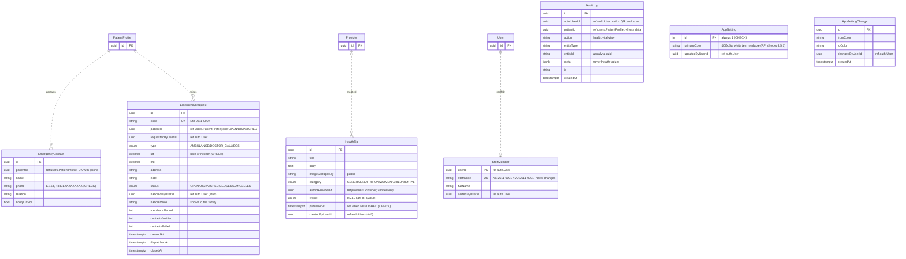

## হেলথস্টোর (শপ)

- Module: `modules/shop`
- Schema: `shop`

- **অ্যাডমিন পুরো দোকান চালু বা বন্ধ করেন** (`ShopSetting.enabled`, শুরুতে বন্ধ; একটাই সারি `id = 1`, CHECK)। বন্ধ থাকলে অ্যাপে দোকানের কিছুই দেখা যায় না, আর দোকানের public ও ক্রেতার API `SHOP_DISABLED` (503) দেয়। ক্রেতা তখনও নিজের আগের অর্ডার দেখতে ও বাতিল করতে পারেন, আর প্যানেল সবসময় চলে। প্রতিটা বদল ShopSettingChange-এ থাকে (append-only)।
- সব নিজেদের: নিজেদের স্টক (একটাই দোকান), নিজেদের ডেলিভারি। অ্যাডমিন ঠিক করেন:
  - ডেলিভারি এলাকা আর চার্জ (DeliveryZone);
  - ক্যাশ অন ডেলিভারি চালু না বন্ধ;
  - সর্বনিম্ন অর্ডার আর ফ্রি ডেলিভারির সীমা।
- **ইনভেন্টরি:**
  - `Product.stockQty` বদলায় শুধু একটা SQL দিয়ে। `stockQty + change >= 0` না হলে কিছুই বদলায় না, তাই স্টক কখনো শূন্যের নিচে নামে না (CHECK-ও আছে)।
  - প্রতিটা বদল StockMovement-এ লেখা হয়, `balanceAfter` সহ।
  - হাতে দেওয়া কারণ (শুধু অ্যাডমিন): RESTOCK, ADJUSTMENT, DAMAGED, EXPIRED_STOCK। অর্ডার থেকে আসা কারণ: ORDER, ORDER_RELEASED, RETURNED।
- **অর্ডার:**
  - কার্ট থেকে হয়। CartItem সার্ভারে থাকে, তাই এক ফোন থেকে আরেক ফোনে যায়।
  - অর্ডারের সময়েই স্টক কেটে রাখা হয়। দাম, নাম আর ঠিকানা অর্ডারে কপি হয়, তাই পরে বদলালেও অর্ডার বদলায় না।
  - `code` = `OD-2611-0042` (counter kind `ORDER`)।
  - প্রতিটা অর্ডার একটা প্রোফাইলের জন্য (`patientId`), আর ক্রেতার সেই প্রোফাইলে EDIT লাগে।
  - ONLINE: PENDING_PAYMENT অবস্থায় থাকে `holdExpiresAt` পর্যন্ত (ডিফল্ট ১৫ মিনিট; BullMQ job আর ২ মিনিটের sweep)।
    - পেমেন্ট সফল হলে (`Payment(purpose = ORDER)`, `payment.succeeded`) PLACED।
    - সময়মতো না দিলে EXPIRED, স্টক ফেরত।
    - EXPIRED হওয়ার পর পেমেন্ট এলে: স্টক থাকলে PLACED, না থাকলে রিফান্ড।
  - CASH_ON_DELIVERY: সরাসরি PLACED।
  - তারপর PLACED → CONFIRMED → DISPATCHED → DELIVERED, স্টাফ প্যানেল থেকে এগিয়ে নেন।
  - ডেলিভারির পর অ্যাডমিন RETURNED করতে পারেন, চাইলে পণ্য স্টকে ফেরত দিয়ে।
  - বাতিল: ক্রেতা DISPATCHED-এর আগে পর্যন্ত পারেন, স্টাফ ডেলিভারির আগে পর্যন্ত। বাতিল হলে স্টক ফেরত আসে। অনলাইনে পরিশোধ করা থাকলে পুরো টাকা রিফান্ড হয় (`payment.refund-requested`)।
  - প্রতিটা অবস্থা বদল OrderEvent-এ থাকে (টাইমলাইন)। ক্রেতা push আর in-app পান, তাতে ওষুধের নাম থাকে না।
- **প্রেসক্রিপশন:**
  - প্রেসক্রিপশন লাগে এমন ওষুধ থাকলে `prescriptionCheck` = AWAITING_PRESCRIPTION।
  - ক্রেতা কাগজের প্রেসক্রিপশনের ছবি দেন (private storage), অথবা ওই প্রোফাইলের একটা ISSUED `RX-…` বেছে নেন। RX যাচাই হয় prescriptions মডিউলের `PrescriptionLookupService` দিয়ে।
  - দেওয়ার পর PENDING_REVIEW। স্টাফ APPROVED বা REJECTED করেন; REJECTED হলে অর্ডার বাতিল আর রিফান্ড।
  - APPROVED বা NOT_NEEDED না হলে অর্ডার CONFIRMED-এ যেতে পারে না (DB CHECK)।
  - স্টাফ অর্ডার খুললে audit-এ যায় (`shop.order.staff.view`)।
- কে কী করেন:
  - যেকোনো স্টাফ (ADMIN, MODERATOR): অর্ডার দেখা, প্রেসক্রিপশন যাচাই, অর্ডার এগিয়ে নেওয়া আর বাতিল।
  - শুধু ADMIN: দোকান চালু/বন্ধ, ক্যাটালগ, স্টক, এলাকা, ব্যানার, পার্টনার আর ফেরত।
- খোঁজা: `pg_trgm` দিয়ে, নাম আর জেনেরিক নামে GIN index। তাই বানান একটু ভুল হলেও পাওয়া যায়।
- ছবি (পণ্য, ক্যাটাগরি, ব্র্যান্ড, ব্যানার, পার্টনার) public storage-এ WebP, ২০০ আর ৮০০ px thumbnail সহ।

```mermaid
erDiagram
ShopSetting {
  int id PK "always 1 (CHECK)"
  boolean enabled "default false"
  boolean cashOnDeliveryEnabled
  decimal minOrderAmount
  decimal freeDeliveryFrom "null = never free"
  int paymentHoldMinutes "5-60, default 15"
  uuid updatedByUserId "ref auth.User"
}
ShopSettingChange {
  uuid id PK
  jsonb changes "field: [before, after]"
  uuid changedByUserId "ref auth.User"
  timestamptz createdAt
}
ProductCategory {
  uuid id PK
  string name
  string slug UK "a-z0-9- (CHECK)"
  enum badge "TRENDING/MUST_HAVE/POPULAR/FEATURED/BEST_SELLER"
  string imageStorageKey "public"
  int sortOrder
  boolean isActive
  boolean showOnHome "a section on the shop home"
}
Brand {
  uuid id PK
  string name
  string slug UK
  string logoStorageKey "public"
  boolean isFeatured
  int sortOrder
  boolean isActive
}
Product {
  uuid id PK
  string sku UK "A-Z0-9- (CHECK)"
  string name "pg_trgm index"
  string genericName "pg_trgm index"
  string strength
  string dosageForm
  string packSize
  string manufacturer
  text description
  uuid categoryId FK
  uuid brandId FK "null when the brand is deleted"
  decimal mrp
  decimal price "0 < price <= mrp (CHECK)"
  int stockQty ">= 0 (CHECK); held and placed orders already taken"
  int lowStockThreshold
  int maxPerOrder "1-100"
  boolean requiresPrescription
  boolean isTrending
  boolean isActive
  string imageStorageKey "public"
}
StockMovement {
  uuid id PK
  uuid productId FK
  int change "<> 0"
  int balanceAfter ">= 0"
  enum reason "RESTOCK/ORDER/ORDER_RELEASED/RETURNED/ADJUSTMENT/DAMAGED/EXPIRED_STOCK"
  uuid orderId FK
  string note
  uuid byUserId "ref auth.User; null = system"
  timestamptz createdAt
}
CartItem {
  uuid userId PK "ref auth.User"
  uuid productId PK
  int qty "1-100"
}
DeliveryZone {
  uuid id PK
  string name
  decimal charge ">= 0"
  string estimate
  int sortOrder
  boolean isActive
}
DeliveryAddress {
  uuid id PK
  uuid userId "ref auth.User; at most 10"
  string label
  string recipientName
  string phone "E.164 BD (CHECK); never logged"
  uuid zoneId FK
  string area
  string addressLine
  boolean isDefault "one per user (partial unique)"
}
Order {
  uuid id PK
  string code UK "OD-2611-0042"
  uuid userId "ref auth.User (buyer)"
  uuid patientId "ref users.PatientProfile"
  enum status "PENDING_PAYMENT/PLACED/CONFIRMED/DISPATCHED/DELIVERED/CANCELLED/EXPIRED/RETURNED"
  enum paymentMethod "ONLINE/CASH_ON_DELIVERY"
  boolean isPaid "online only (CHECK)"
  decimal subtotal
  decimal deliveryCharge
  decimal total "= subtotal + deliveryCharge (CHECK)"
  decimal savings
  string recipientName "copied"
  string phone "copied, E.164"
  string zoneName "copied"
  string area "copied"
  string addressLine "copied"
  string note
  timestamptz holdExpiresAt "only while PENDING_PAYMENT (CHECK)"
  enum prescriptionCheck "NOT_NEEDED/AWAITING_PRESCRIPTION/PENDING_REVIEW/APPROVED/REJECTED"
  uuid prescriptionId "ref prescriptions.Prescription (ISSUED)"
  string prescriptionStorageKey "private photo"
  string prescriptionReviewNote
  uuid prescriptionReviewedBy "ref auth.User (staff)"
  string cancelReason
}
OrderItem {
  uuid id PK
  uuid orderId FK
  uuid productId FK
  string name "copied"
  string packSize "copied"
  decimal unitPrice "copied"
  decimal mrp "copied"
  int qty
  decimal lineTotal "= unitPrice * qty (CHECK)"
  boolean requiresPrescription
}
OrderEvent {
  uuid id PK
  uuid orderId FK
  enum status
  string note
  uuid byUserId "ref auth.User; null = system"
  timestamptz createdAt
}
ShopBanner {
  uuid id PK
  string title
  string imageStorageKey "public; no picture = not shown"
  enum linkType "NONE/CATEGORY/PRODUCT/BRAND/URL"
  string linkValue
  int sortOrder
  boolean isActive
  timestamptz startsAt
  timestamptz endsAt
}
DiscountPartner {
  uuid id PK
  string name
  string offerText
  text description
  string address
  string phone "E.164 BD (CHECK)"
  string logoStorageKey "public"
  int sortOrder
  boolean isActive
}
ProductCategory ||--o{ Product : "has"
Brand |o--o{ Product : "makes"
Product ||--o{ StockMovement : "ledger"
Product ||--o{ CartItem : "in carts"
DeliveryZone ||--o{ DeliveryAddress : "covers"
Order ||--o{ OrderItem : "lines"
Order ||--o{ OrderEvent : "timeline"
Order |o--o{ StockMovement : "moves"
Product ||--o{ OrderItem : "sold as"
User ||..o{ Order : "buys"
PatientProfile ||..o{ Order : "for"
Prescription |o..o{ Order : "attached RX"
```

## কোর (সব মডিউলের জন্য)

- Module: `core/readable-ids`
- Schema: `core`

মানুষকে দেখানো ID-র (`PR-2611-0042`) "শেষ নম্বর + ১" রাখা হয় এখানে, প্রতিটা ধরন (PATIENT, DOCTOR, NUTRITIONIST, PHYSIO, MODERATOR, ADMIN, BOOKING, PAYMENT, PAYOUT, PRESCRIPTION, EMERGENCY, ORDER) আর মাসের জন্য একটা সারি। বুকিং কোড (`BK-2611-0042`), রসিদ (`RC-…`) পেআউট নম্বর (`ST-…`) প্রেসক্রিপশন নম্বর (`RX-…`) জরুরি অনুরোধের নম্বর (`EM-…`) আর হেলথস্টোরের অর্ডার নম্বরও (`OD-…`) একই টেবিল থেকে আসে, kind `BOOKING`/`PAYMENT`/`PAYOUT`/`PRESCRIPTION`/`EMERGENCY`/`ORDER`। `INSERT … ON CONFLICT DO UPDATE SET lastValue = lastValue + 1 RETURNING` দিয়ে একবারে বাড়ানো হয়, তাই দুজন একসাথে পেলেও নম্বর আলাদা হয়।

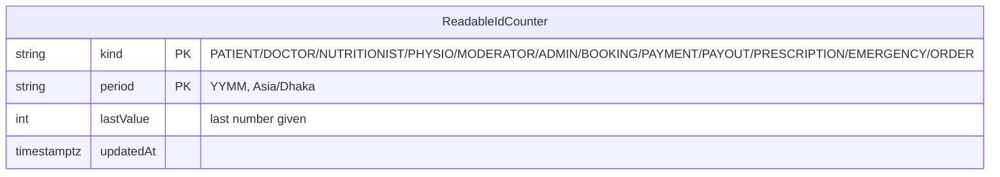

## এনক্রিপশন (সারসংক্ষেপ)

কোন কলাম এনক্রিপ্ট হয়, তা এক জায়গায়। পদ্ধতি হলো AES-256-GCM, প্রতিটা মানের জন্য নতুন IV, আর key আসে env থেকে। পরে key rotation যাতে করা যায়, তাই ciphertext-এর শুরুতে key version থাকে।

| Schema | Encrypted (`enc`) | Plain রাখা, কারণ query বা index লাগে |
|---|---|---|
| `health` | `MedicalCondition.name`, `.note`, `VitalReading.note` | ভাইটালের সংখ্যা, type, status, measuredAt |
| `records` | `MedicalFile.title` | type, reportDate, storageKey |
| `payments` | `ProviderPayoutAccount.accountNumberEnc` | accountNumberLast4 (দেখানোর জন্য), method |
| `prescriptions` | `Prescription.chiefComplaint`, `.diagnosis`, `.advice` | ওষুধের লাইন (অ্যালার্ম বানাতে লাগে), status, তারিখ |
| `chat` | `Message.body`, `Message.attachmentStorageKey` | conversationId, createdAt, type |
| `womens_health` | বাকি সব কলাম | id, patientId, providerId, `date`/`startDate`, status, appLockEnabled, remindersOn, avgCycleDays, avgPeriodDays |

ফাইলগুলো নিজে (রিপোর্ট আর ছবি) প্রাইভেট স্টোরেজে থাকে। এগুলো দেখা যায় শুধু অনুমতি চেক আর মেয়াদওয়ালা লিংক (presigned URL) দিয়ে।
