# দৈনিক স্বাস্থ্য — ER Diagram (all modules)

PostgreSQL + Prisma `multiSchema`. One schema per NestJS module.

Conventions used in every diagram below:
- Solid lines (`--`) = real FK constraint, both tables in the same module/schema. Only these columns are marked `FK`.
- Dashed lines (`..`) = cross-module reference by id only. **No FK constraint**; the column comment says `ref <Module>.<Table>`, and the data is read through the owning module's exported service.
- Boxes with only `id PK` are references to another module's table.
- Every table also has `createdAt`, `updatedAt` (not shown).
- Columns marked `enc` are encrypted at the application level (stored as ciphertext `bytea`). They cannot be filtered, sorted or indexed in SQL. See "এনক্রিপশন" at the end.
- File columns store only a `storageKey` (e.g. `private/2026/11/<uuid>.webp`), never a URL. The API builds the URL through `StorageService` (local disk today, S3 later).

## এক নজরে: মূল সম্পর্ক

- Module: `সব মডিউল`
- Schema: `—`

শুধু মূল টেবিলগুলো আর তাদের সম্পর্ক দেখানো হয়েছে। প্রতিটা মডিউলের পুরো কলাম নিচে আলাদা করে দেওয়া আছে। একটা বাদে সব লাইন ড্যাশ, কারণ সেগুলো এক মডিউল থেকে আরেক মডিউলে যায়। ব্যতিক্রম PatientProfile → ProfileMember, দুটোই users মডিউলের। Payment কোন জিনিসের জন্য, সেটা Payment নিজেই `purpose + referenceId` দিয়ে ধরে রাখে। Appointment বা Consultation-এ paymentId নেই।

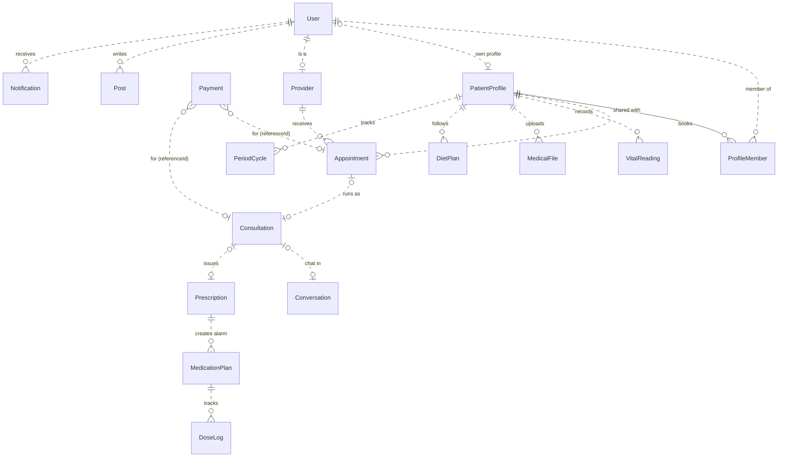

## অথ ও ইউজার

- Module: `modules/auth, modules/users`
- Schema: `auth, users`

লগইন হয় **ইমেইল আর ৬ সংখ্যার পিন** দিয়ে, সাথে ইমেইলে OTP, ডিভাইস আর সেশন। সাইনআপ, ইমেইল-কোডে লগইন আর পিন রিসেট, তিনটাতেই কোড যায় ইমেইলে (nodemailer, SMTP)। ফোন নম্বর আর SMS OTP পরে চালু হবে, তখন `phone` (E.164, শুধু বাংলাদেশি `+8801XXXXXXXXX`) যাচাই করে যোগ হবে। তাই এখন `email` আর `phone` দুটোই nullable ও unique। Guest ইউজারের ইমেইল, ফোন বা পিন কিছুই থাকে না, এটা DB-তে CHECK দিয়ে বাঁধা।

- ইমেইল সবসময় lowercase করে রাখা হয় (DB-তে CHECK), যাতে একই ঠিকানায় দুটো অ্যাকাউন্ট না হয়।
- OTP কোড প্লেইন টেক্সটে থাকে না, থাকে HMAC-SHA256 হিসেবে। একই ঠিকানায় এক মিনিটে একটা আর ঘণ্টায় পাঁচটা কোড যায়, আর প্রতিটা কোডে পাঁচবার ভুল চেষ্টা করা যায়। নতুন কোড গেলে আগেরটা আর কাজ করে না।
- কোড যাচাই হলে একবার ব্যবহারযোগ্য একটা verification token আসে। সেটা খরচ হলে `OtpCode.consumedAt` বসে।
- পিন পরপর পাঁচবার ভুল হলে পিন-লগইন ১৫ মিনিট বন্ধ থাকে (`pinLockedUntil`), আর প্রতি পরের পাঁচ ভুলে সময় দ্বিগুণ হয় (সর্বোচ্চ ২৪ ঘণ্টা)। ইমেইল-কোডে লগইন করলে লক খুলে যায়।
- Refresh token প্রতিবার বদলায়। পুরনো token আবার এলে পুরো সেশন বাতিল হয়।
- একটা অ্যাপ ইনস্টলে (`Device.installationId`) একবারে একটা অ্যাকাউন্টই থাকে। অন্য কেউ লগইন করলে আগের জনের সেশন বাতিল হয় আর তার push token মুছে যায়।

সব স্বাস্থ্য ডেটা যুক্ত থাকে PatientProfile-এর সাথে, User-এর সাথে না। কোন User কোন প্রোফাইল দেখতে বা চালাতে পারবে, সেটা ঠিক হয় **ProfileMember** দিয়ে। এতে দুই ভাইবোন একই বাবার প্রোফাইল একসাথে চালাতে পারে।

- বাবা বা মায়ের নিজের অ্যাপ অ্যাকাউন্ট থাকলে সেটা `linkedUserId` দিয়ে প্রোফাইলের সাথে লিংক হয়। নিজে প্রোফাইল বানালে (`relation = SELF`) অথবা `relation = SELF` আমন্ত্রণ গ্রহণ করলে লিংক হয়। একটা User-এর নিজের প্রোফাইল একটাই।
- নতুন caregiver যোগ হয় ProfileInvite দিয়ে। আমন্ত্রিত ব্যক্তির ইমেইলে খবর যায়। ওই ইমেইল দিয়ে লগইন করে (যেটা সাইনআপের সময় OTP দিয়ে যাচাই করা) অ্যাপ থেকে গ্রহণ করতে হয়, তাই আলাদা কোড লাগে না। আমন্ত্রণ ৭ দিন থাকে। একই প্রোফাইলে একই ইমেইলে একসাথে একটাই PENDING আমন্ত্রণ থাকতে পারে (partial unique index)।
- `relation` রাখা থাকে ProfileMember-এ, কারণ একই মানুষ একজনের বাবা আর আরেকজনের শ্বশুর হতে পারেন। `relation` মানে "এই প্রোফাইলের রোগী আমার কে"।
- একটা প্রোফাইলে কমপক্ষে একজন OWNER থাকতেই হবে। এটা service-এ প্রোফাইলের row lock (`SELECT ... FOR UPDATE`) নিয়ে চেক হয়।
- uuid শুধু ভেতরের key, মানুষকে দেখানো হয় না। দেখানো হয় `patientCode`, যেমন `PR-2611-0042`: অ্যাপে, QR হেলথ কার্ডে আর ডাক্তারের কাছে।
  - `P` = রোগী (ডাক্তার `D`, পুষ্টিবিদ `N`, ফিজিও `T`, মডারেটর `M`, অ্যাডমিন `A`), `R` = নামের প্রথম অক্ষর ইংরেজিতে (বাংলা নাম থেকেও: "রহিম" → R; "ডা.", "মো.", "Md." বাদ), `2611` = তৈরির বছর-মাস (ঢাকার সময়), `0042` = ওই মাসে ওই ধরনের কততম।
  - নম্বর আসে `core.ReadableIdCounter` থেকে: আগের শেষ নম্বর + ১, একটাই atomic SQL-এ, তাই একসাথে দুজন সাইনআপ করলেও একই নম্বর পায় না।
  - ID কখনো বদলায় না (নাম বদলালেও না), আর মুছে যাওয়া প্রোফাইলের নম্বর আর কেউ পায় না। ফরম্যাট DB-তে CHECK দিয়ে বাঁধা।
- প্রোফাইল ডিলিট হয় soft delete (`deletedAt`), কারণ অন্য মডিউলের সারিগুলো এই id ধরে রাখে। ডিলিট হলে `linkedUserId` খালি হয় আর PENDING আমন্ত্রণ বাতিল হয়।

Role permissions:

| Role | স্বাস্থ্য ডেটা দেখা | ডেটা যোগ ও বদলানো | মেম্বার যোগ ও বাদ | প্রোফাইল ডিলিট |
|---|---|---|---|---|
| OWNER | ✓ | ✓ | ✓ | ✓ |
| CAREGIVER | ✓ | ✓ | — | — |
| VIEWER | ✓ | — | — | — |

নারীস্বাস্থ্যের ডেটা শুধু সেই প্রোফাইলের `linkedUserId` দেখতে পারে, অথবা ওই প্রোফাইলের OWNER, যদি প্রোফাইলের নিজের অ্যাকাউন্ট না থাকে। CAREGIVER বা VIEWER এই ডেটা দেখতে পারে না।

## স্বাস্থ্য প্রোফাইল ও রেকর্ড

- Module: `modules/health-profile, modules/records`
- Schema: `health, records`

এই অংশে আছে ভাইটালস (রক্তচাপ, শর্করা, ওজন), দীর্ঘমেয়াদি রোগ ও অ্যালার্জি, QR হেলথ কার্ড, আর ল্যাব রিপোর্ট বা প্রেসক্রিপশনের ফাইল।

- ফাইল থাকে প্রাইভেট স্টোরেজে: আজ `storage/private`, পরে S3। ডাক্তারের সাথে শেয়ার হয় মেয়াদসহ।
- ভাইটালের সংখ্যাগুলো এনক্রিপ্ট করা হয় না, কারণ ট্রেন্ড চার্ট আর status ফিল্টার SQL-এ চলে।
- রোগের নাম, নোট আর ফাইলের টাইটেল এনক্রিপ্ট করা হয়।
- `status` API নিজে হিসাব করে (`vital-status.ts`)। ওজনের status আসে BMI থেকে (WHO-র এশিয়ান মান), তাই প্রোফাইলে উচ্চতা না থাকলে `status` খালি (null) থাকে।
- DB-তে CHECK: BP হলে শুধু `systolic`/`diastolic` (systolic > diastolic), বাকি সব type-এ শুধু `value`। `context` থাকে শুধু GLUCOSE-এ।
- ছবি WebP হিসেবে রাখা হয়, সাথে 200px আর 800px thumbnail (`private/thumbs/<width>/<yyyy>/<mm>/<uuid>.webp`)। PDF যেমন আছে তেমন থাকে। `mimeType` শুধু `image/webp` বা `application/pdf` (CHECK)। ফাইল ডিলিট হলে স্টোরেজ থেকে ফাইল মুছে যায়, সারিটা `deletedAt` দিয়ে audit-এর জন্য থাকে।
- QR কোডে থাকে শুধু একটা র‍্যান্ডম `qrToken`। স্ক্যান করলে লগইন ছাড়াই জরুরি সারসংক্ষেপ দেখা যায় (নাম, বয়স, রক্তের গ্রুপ, রোগ, অ্যালার্জি, সার্জারি; নোট না), আর প্রতিটা স্ক্যান HealthCardAccess-এ লেখা হয়। নতুন কার্ড দিলে পুরনো QR আর কাজ করে না।
- MedicalFileShare-এর route আসবে doctors + appointments মডিউলের সাথে।

## ডাক্তার ও সেবাদাতা

- Module: `modules/doctors`
- Schema: `providers`

ডাক্তার, পুষ্টিবিদ আর ফিজিওথেরাপিস্ট সবাই একই Provider টেবিলে থাকেন, `type` দিয়ে আলাদা করা হয়।

- BMDC নম্বর ইউনিক, আর ভেরিফিকেশন ডকুমেন্ট দেখে যাচাই হয়।
- `gender` রাখা হয়েছে যাতে নারী ডাক্তার দিয়ে ফিল্টার করা যায়। ৳১০-এর নারীস্বাস্থ্য কনসাল্ট শুধু নারী ডাক্তারের কাছে যায়।
- Chamber মানে ডাক্তার কোন হাসপাতালে বসেন। স্লট তৈরি হয় Schedule থেকে।
- চেম্বারে সময় না দিয়ে সিরিয়াল দেওয়া হয়, তাই IN_PERSON Schedule-এ `maxPatients` থাকে। ভিডিও আর চ্যাটে আলাদা সময়ের স্লট থাকে।

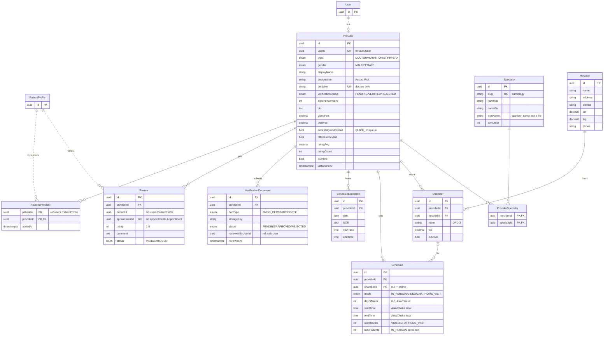

## অ্যাপয়েন্টমেন্ট ও ফলো-আপ

- Module: `modules/appointments`
- Schema: `appointments`

চেম্বার, ভিডিও, চ্যাট আর হোম ভিজিট, চারটাই একটা Appointment টেবিলে থাকে, `mode` দিয়ে আলাদা করা হয়।

- ফলো-আপ হলো আগের অ্যাপয়েন্টমেন্টের সাথে যুক্ত একটা নতুন অ্যাপয়েন্টমেন্ট।
- অ্যাপের বাইরের কোনো ডাক্তারের ফলো-আপ ইউজার নিজে যোগ করলে সেটা FollowUpReminder-এ যায়।

**পেমেন্টের লিংক:** Appointment-এ paymentId নেই। কোন অ্যাপয়েন্টমেন্টের পেমেন্ট, তা পাওয়া যায় `Payment(purpose = APPOINTMENT, referenceId = appointment.id)` থেকে। পেমেন্ট সফল হলে `payment.succeeded` event আসে আর Appointment CONFIRMED হয়।

**স্লট হোল্ড:** বুকিং হলেই Appointment `PENDING_PAYMENT` অবস্থায় যায়, আর `holdExpiresAt` বসে এখন থেকে ১০ মিনিট পরে। একই সাথে একটা BullMQ delayed job যোগ হয়। সময়ের মধ্যে পেমেন্ট না এলে status হয় `EXPIRED` আর স্লট আবার খুলে যায়।

**Double booking ঠেকানো** (দুটোই partial unique index, migration-এ raw SQL হিসেবে):
- IN_PERSON, সিরিয়াল ভিত্তিক: `UNIQUE (scheduleId, sessionDate, serialNo) WHERE mode = 'IN_PERSON' AND status NOT IN ('CANCELLED','EXPIRED')`। serialNo দেওয়া হয় একটা transaction-এর ভেতরে `SELECT ... FOR UPDATE` দিয়ে। সিরিয়াল `maxPatients` ছাড়াতে পারবে না।
- VIDEO, CHAT আর HOME_VISIT, সময় ভিত্তিক: `UNIQUE (providerId, scheduledAt) WHERE mode <> 'IN_PERSON' AND status NOT IN ('CANCELLED','EXPIRED')`।

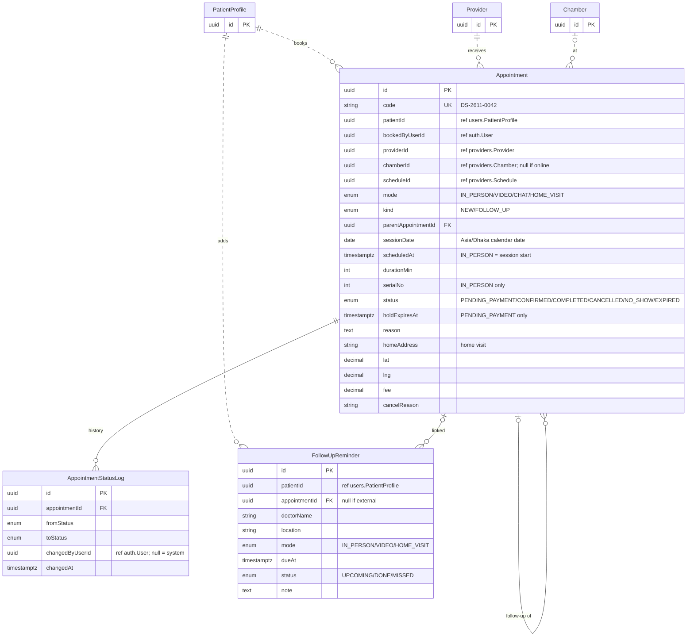

## পরামর্শ ও বার্তা

- Module: `modules/consultation, modules/chat`
- Schema: `consultation, chat`

এই অংশে আছে ভিডিও, অডিও আর চ্যাট সেশন।

- **৳১০-এর দ্রুত পরামর্শ (`QUICK_10`) শুধু চ্যাটে হয়।** এটা DB-তে বাঁধা থাকে: `CHECK (tier <> 'QUICK_10' OR channel = 'CHAT')`।
- দ্রুত পরামর্শে আগে থেকে কোনো অ্যাপয়েন্টমেন্ট থাকে না। রোগী কিউতে ঢোকে, আর অনলাইন ডাক্তার পাওয়া গেলে সেশন শুরু হয়।
- নারীস্বাস্থ্যের কিউতে `requiredProviderGender = FEMALE` থাকে। তখন শুধু `Provider.gender = FEMALE` এবং `acceptsQuickConsult = true` ডাক্তার assign হন।
- পেমেন্ট খোঁজা হয় `Payment(purpose = QUICK_CONSULT, referenceId = consultation.id)` দিয়ে।
- চ্যাট মেসেজ আসে Socket.io দিয়ে আর জমা থাকে Message টেবিলে। মেসেজের body আর attachment এনক্রিপ্ট করা থাকে।

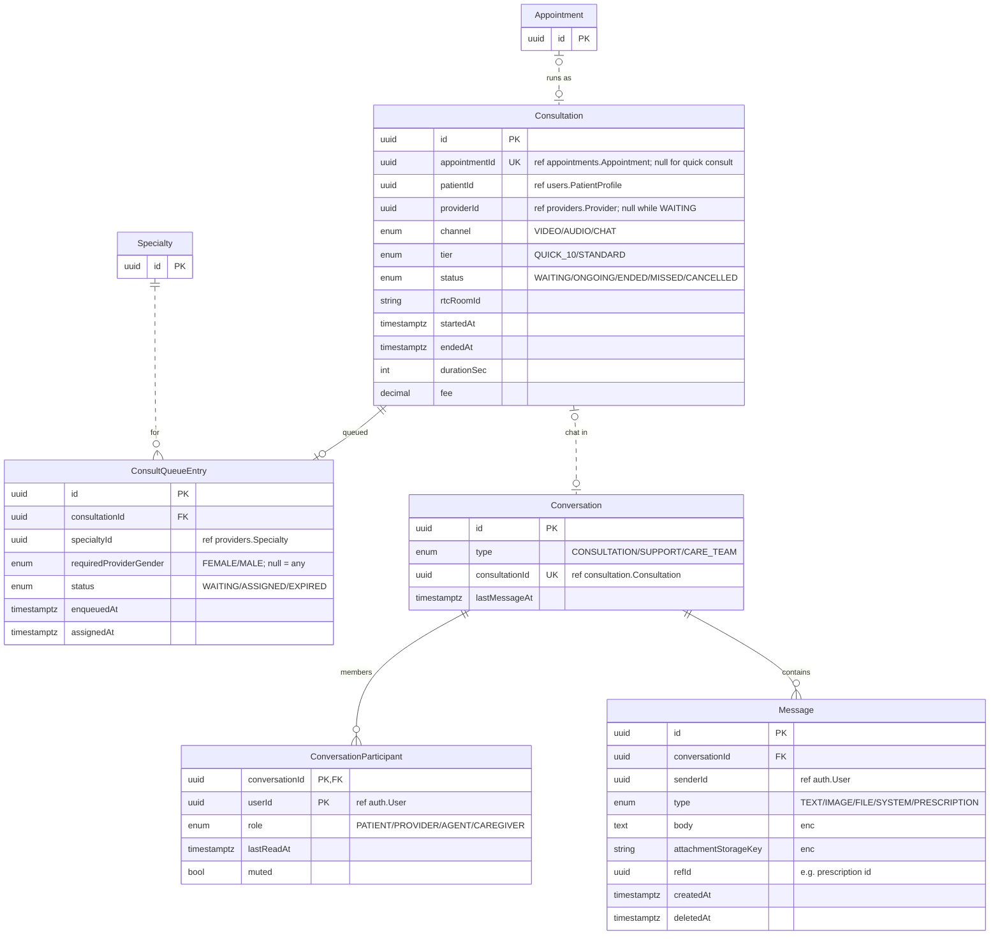

## ডিজিটাল প্রেসক্রিপশন

- Module: `modules/prescriptions`
- Schema: `prescriptions`

ডাক্তার পরামর্শ শেষে প্রেসক্রিপশন ইস্যু করেন। প্রতিটা ওষুধ একটা PrescriptionItem।

- রোগী এক ট্যাপে PrescriptionItem থেকে মেডিসিন অ্যালার্ম বানাতে পারে। তখন `dosePattern` (যেমন `1+0+½`) ভেঙে প্রতিটা সময়ের জন্য আলাদা ডোজসহ MedicationTime তৈরি হয়।
- টেস্টের রিপোর্ট আপলোড হলে সেটা PrescribedTest-এর সাথে যুক্ত হয়।

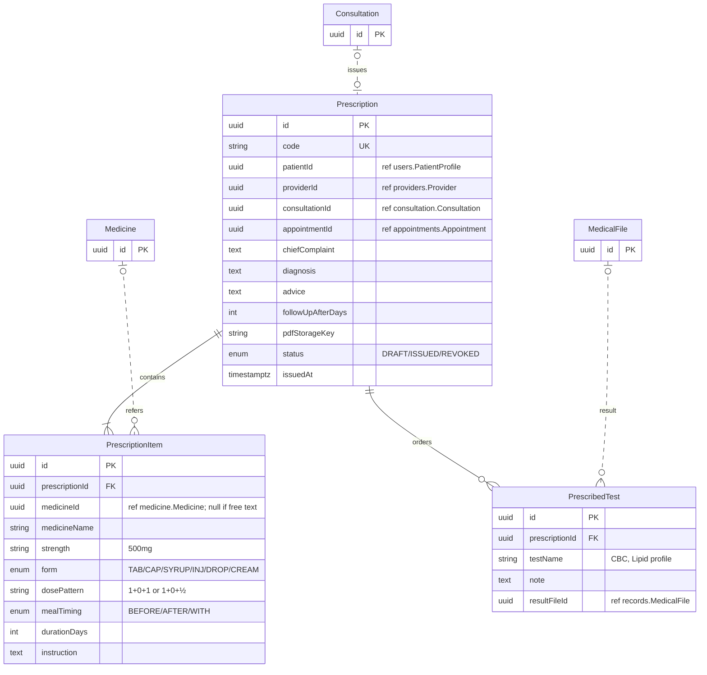

## মেডিসিন অ্যালার্ম

- Module: `modules/medicine`
- Schema: `medicine`

প্রতিটা ওষুধের জন্য একটা MedicationPlan থাকে। দিনে কখন আর কতটা খাবে, তা থাকে MedicationTime-এ।

- ডোজের পরিমাণ রাখা হয়েছে MedicationTime-এ, কারণ `1+0+½`-এর মতো প্যাটার্নে সকাল আর রাতের ডোজ আলাদা।
- প্রতিটা নির্ধারিত ডোজের জন্য একটা DoseLog তৈরি হয়। ‘৩টির মধ্যে ২টি নেওয়া হয়েছে’ আর সঠিক সময়ে সেবনের হার সেখান থেকেই আসে।
- `stockQty` decimal, কারণ আধা ট্যাবলেটও খাওয়া হয়। TAKEN হলে stock থেকে ডোজ বাদ যায়। বাকি stock দিয়ে কত দিন চলবে, সেটা `refillAlertDays`-এর সমান বা কম হলে রিফিল অ্যালার্ট যায়।

**অ্যালার্ম কীভাবে বাজে:**
- ডোজের অ্যালার্ম শুধু ফোনে বাজে, লোকাল `expo-notifications` দিয়ে, যাতে অফলাইনেও কাজ করে।
- সার্ভার ডোজের জন্য push পাঠায় না।
- সার্ভার শুধু একটা `DOSE_BACKUP` রিমাইন্ডার রাখে। নির্ধারিত সময়ের X মিনিট পরেও DoseLog TAKEN বা SKIPPED না হলে রোগীকে SMS যায়। একই সাথে `receivesAlerts` চালু থাকা caregiver-দের কাছে push যায়।

**ডোজ কীভাবে তৈরি ও হিসাব হয়:**
- সার্ভার প্রতি ৩০ মিনিটে চালু থাকা প্ল্যানের পরের ৩৬ ঘণ্টার ডোজ (PENDING DoseLog) আর প্রতিটার `DOSE_BACKUP` আগে থেকে বানিয়ে রাখে। প্ল্যান যোগ বা বদলালে সাথে সাথেই বানায়। `(planId, scheduledFor)` unique, তাই একই ডোজ দুবার হয় না।
- অ্যাপ ডোজ চিহ্নিত করে প্ল্যান আর সময় দিয়ে (DoseLog id লাগে না)। তাই অফলাইনে "সেবন করেছি" চাপলে নেট এলে পরে পাঠানো যায়। PENDING পাঠালে আগের চিহ্ন বাতিল (ভুল চাপলে undo), আর TAKEN বাতিল হলে stock ফেরত যায়।
- Snooze করলে backup সরে যায়: ডোজের সময় আর snooze শেষ, এর যেটা পরে, তার X মিনিট পর।
- কেউ ৬ ঘণ্টায় কিছু না করলে ডোজ MISSED হয়। সেবনের হার = যে ডোজগুলোর সময় পেরিয়েছে তার মধ্যে TAKEN কয়টা। সময়ের ১ ঘণ্টার মধ্যে নিলে "সময়মতো"।
- প্ল্যান যোগ করার আগের সময়ের ডোজ হিসাবে আসে না (বিকেল ৩টায় যোগ করলে সকাল ৮টার ডোজ বাকি দেখায় না)।
- প্ল্যান বন্ধ (stop) করলে `isActive = false` আর `stoppedAt` বসে। আগের ইতিহাস থাকে, ভবিষ্যতের ডোজ আর backup মুছে যায়। ভুল করে যোগ হলে delete করা যায় (ইতিহাসসহ)।
- রিফিল অ্যালার্ট: stock `refillAlertDays` দিনের বা কম থাকলে, দিনে সর্বোচ্চ একবার, যতক্ষণ না stock বাড়ানো হয়।
- প্রোফাইল ডিলিট হলে তার সব প্ল্যান বন্ধ হয় আর রিমাইন্ডার বাতিল হয়।
- ওষুধ খোঁজা (`Medicine`) ব্র্যান্ড বা জেনেরিক নামে, বানান ভুল হলেও (pg_trgm GIN index)। ক্যাটালগে না থাকলে রোগী নিজে নাম লিখে যোগ করতে পারে (`medicineId` খালি)।
- `doseUnit` নির্দিষ্ট মানের একটা: TABLET, CAPSULE, ML, SPOON, DROP, PUFF, UNIT, SACHET, APPLICATION (অ্যাপ বাংলায় দেখায়)।
- DB-তে CHECK: dose > 0, `daysMask` ১–১২৭, stock ≥ ০, `endDate ≥ startDate`, `isActive = (stoppedAt IS NULL)`, SNOOZED হলে `snoozedUntil` থাকতেই হবে।

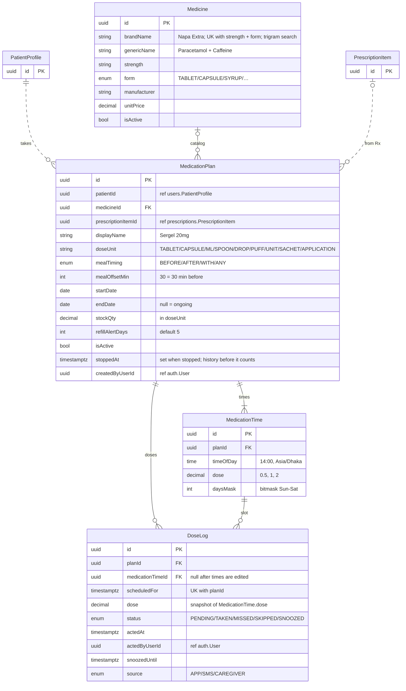

## পুষ্টিবিদ ও ডায়েট চার্ট

- Module: `modules/nutrition`
- Schema: `nutrition`

পুষ্টিবিদ (Provider, `type = NUTRITIONIST`) রোগীর জন্য DietPlan বানান। তাতে থাকে সকাল, দুপুর, বিকাল আর রাতের খাবার। প্রতিদিনের ক্যালরি আর পানির হিসাব থাকে IntakeLog-এ, প্রতি রোগীর প্রতি দিনে একটা সারি।

> ⚠️ ডায়েট প্ল্যানের পেমেন্ট কীভাবে হবে, তা এখনো ঠিক হয়নি (CLAUDE.md → Open decisions)। এখনকার ধারণা হলো পুষ্টিবিদের সাথে বুকিং হয় সাধারণ Appointment দিয়ে (`purpose = APPOINTMENT`), আর DietPlan সেই `appointmentId`-এর সাথে যুক্ত থাকে।

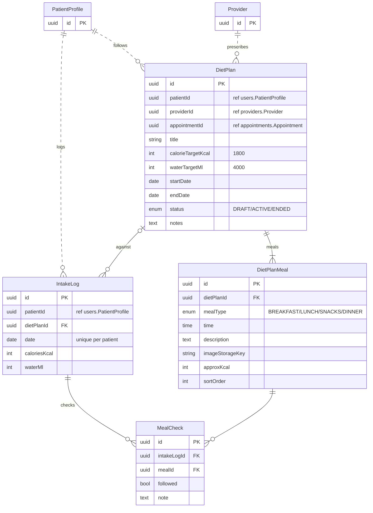

## নারীস্বাস্থ্য ও পিরিয়ড ট্র্যাকার

- Module: `modules/womens-health`
- Schema: `womens_health`

এই অংশে আছে পিরিয়ডের তারিখ, প্রতিদিনের লক্ষণ ও মেজাজ, আর গর্ভধারণ ট্র্যাকিং।

- পরবর্তী পিরিয়ড আর গর্ভধারণের সম্ভাবনা হিসাব হয় গড় চক্র থেকে। অনুমান করা সারিতে `isPredicted = true` থাকে।
- **এনক্রিপশন:** id, patientId, আর query বা unique-এর জন্য লাগে এমন `date`/`startDate` বাদে এই schema-র সব কলাম `enc`।
- অনুমানের হিসাব করে service, একজন রোগীর ডেটা decrypt করে। একজনের ডেটা অল্প, তাই এটা দ্রুত হয়।
- **অ্যাপ লক:** `appLockEnabled` শুধু একটা ফ্ল্যাগ। লক PIN সার্ভারে যায় না। সেটা ফোনের `expo-secure-store`-এ থাকে, আর চাইলে বায়োমেট্রিক দিয়েও খোলা যায়।
- এই ডেটা কারা দেখতে পারবে, তা "অথ ও ইউজার" অংশের permission table-এ আছে।

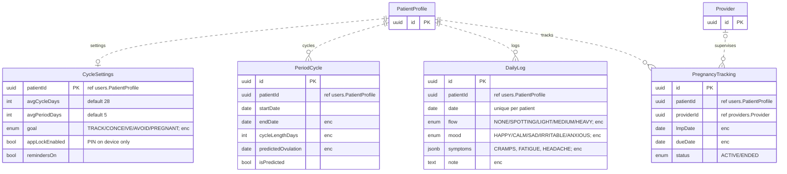

## কমিউনিটি ও ফোরাম

- Module: `modules/community`
- Schema: `community`

এই অংশে আছে পোস্ট, উত্তর, রিঅ্যাকশন আর রিপোর্ট।

- বেনামী পোস্টেও `authorUserId` জমা থাকে মডারেশনের জন্য, শুধু অন্যদের দেখানো হয় না।
- উত্তরে `providerId` থাকলে সেটা ‘ভেরিফাইড ডাক্তার জবাব’।
- রিঅ্যাকশন আর রিপোর্ট পোস্ট ও উত্তর দুটোতেই কাজ করে।
- **নারীদের প্রাইভেট ফোরাম:** `audience = WOMEN_ONLY` ক্যাটাগরি দেখতে আর পোস্ট করতে পারে শুধু তারা:
  - যাদের নিজের প্রোফাইলে (`PatientProfile.linkedUserId = user.id`) `gender = FEMALE`, অথবা
  - যারা `Provider.gender = FEMALE`, অথবা
  - MODERATOR আর ADMIN।

  লিস্ট আর সার্চ দুই জায়গাতেই এই চেক service-এ হয়।

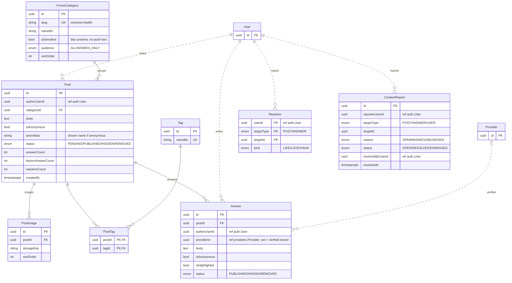

## পেমেন্ট ও পেআউট

- Module: `modules/payments`
- Schema: `payments`

bKash বা Nagad-এর প্রতিটা চেষ্টা একটা আলাদা GatewayTransaction। কলব্যাকের পুরো JSON সেখানেই জমা থাকে।

- **লিংক কোন দিকে:** Payment কোন জিনিসের জন্য, তা Payment নিজেই ধরে রাখে `purpose + referenceId` দিয়ে। Appointment বা Consultation-এ paymentId নেই।
- Payment সফল হলে `payment.succeeded` event যায়, আর তখন অ্যাপয়েন্টমেন্ট বা পরামর্শ CONFIRMED হয়।
- একটা `referenceId`-এর জন্য একসাথে একটাই সক্রিয় পেমেন্ট থাকতে পারে: `UNIQUE (purpose, referenceId) WHERE status IN ('INITIATED','SUCCESS')`।
- প্রতিটা সফল পেমেন্ট থেকে ডাক্তারের আয় (ProviderEarning, `kind = EARNING`) হিসাব হয়, আর মাস শেষে Payout হয়।
- **Payout হয়ে যাওয়ার পরে refund এলে** একটা negative `REFUND_ADJUSTMENT` সারি তৈরি হয়। সেটা পরের Payout থেকে কাটা যায়, কারণ আগের Payout বদলানো হয় না।

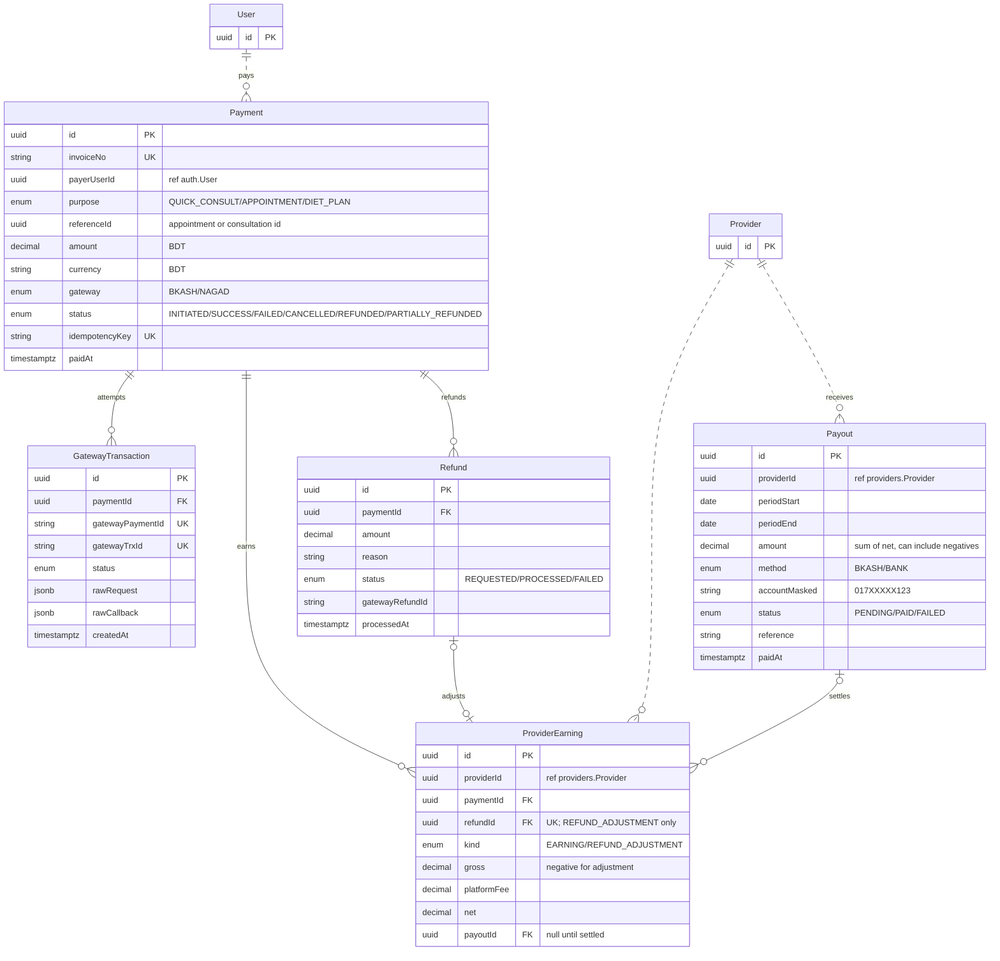

ProviderEarning-এর index:
- `UNIQUE (paymentId) WHERE kind = 'EARNING'`
- `UNIQUE (refundId) WHERE refundId IS NOT NULL`

## নোটিফিকেশন ও রিমাইন্ডার

- Module: `modules/notifications`
- Schema: `notifications`

ফলো-আপ, অ্যাপয়েন্টমেন্ট, রিফিল, পিরিয়ড আর ডোজের SMS ব্যাকআপ, সব সার্ভার রিমাইন্ডার এক জায়গায় থাকে।

- ডোজের মূল অ্যালার্ম লোকাল, তাই এখানে থাকে শুধু `DOSE_BACKUP` ("মেডিসিন অ্যালার্ম" অংশ দেখো)।
- ScheduledReminder-এর `jobId` দিয়ে BullMQ-এর কাজ বাতিল বা বদলানো যায়।
- প্রতিটা আসল পাঠানো (Push, SMS, ইন-অ্যাপ) একটা Notification সারি।
- `isSensitive` ক্যাটাগরি আর নারীস্বাস্থ্যের নোটিফিকেশনের লেখায় স্বাস্থ্য তথ্য থাকে না, শুধু থাকে “আপনার একটি রিমাইন্ডার আছে”।
- একই জিনিসের (একই `kind` + `refId`) একসাথে একটাই SCHEDULED রিমাইন্ডার থাকে (partial unique index)। নতুন করে schedule করলে আগেরটা CANCELLED হয়।
- রিমাইন্ডার বাজার মুহূর্তে মালিক মডিউল (যেমন medicine) ঠিক করে কাকে কী পাঠাবে। ততক্ষণে ডোজ নেওয়া হয়ে গেলে কিছু যায় না, রিমাইন্ডার CANCELLED হয়। `userId` মূল প্রাপক; `receivesAlerts` চালু পরিবারের সদস্যরাও পায়।
- Redis চলে গেলেও রিমাইন্ডার হারায় না: প্রতি ১০ মিনিটে দেরি হওয়া বা job ছাড়া SCHEDULED রিমাইন্ডার আবার queue-তে যায়। দুবার পাঠানো ঠেকাতে পাঠানোর আগে সারিটা SENT করে নেওয়া হয়।
- Push যায় Expo push service দিয়ে, শুধু সেই ফোনে যেখানে লগইন আছে। অ্যাপ মুছে ফেললে (`DeviceNotRegistered`) token মুছে যায়।
- SMS gateway এখনো ঠিক হয়নি (CLAUDE.md §3), আর ফোন নম্বরও এখন নেওয়া হয় না। তাই SMS-এর Notification সারি সৎভাবে FAILED থাকে (`NO_PHONE` / `SMS_PROVIDER_NOT_CONFIGURED`)।
- Quiet hours (`quietStart`–`quietEnd`, ঢাকার সময়, মাঝরাত পেরোতে পারে): এ সময়ে push শব্দ ছাড়া আসে। ডোজ মিস হওয়ার সতর্কতা (`urgent`) তবুও শব্দ করে।
- অ্যাপের ঘণ্টা আইকনের তালিকা = `channel = IN_APP` সারিগুলো। প্রতিটা চ্যানেলের চেষ্টা আলাদা সারি; ব্যর্থ হলে `failureReason`-এ কারণের কোড থাকে, বার্তার লেখা কখনো না।

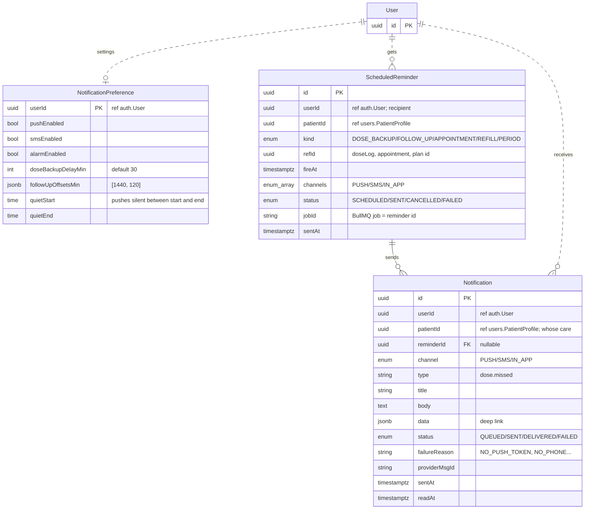

## আকস্মিক সেবা, কনটেন্ট ও অ্যাডমিন

- Module: `modules/emergency, modules/content, modules/admin`
- Schema: `emergency, content, admin`

- হোম স্ক্রিনের ‘আকস্মিক সেবা’ বাটন একটা EmergencyRequest তৈরি করে। তখন জরুরি কন্টাক্টদের জানানো হয়, আর `receivesAlerts` চালু থাকা caregiver-দের কাছেও খবর যায়।
- স্বাস্থ্য সচেতনতার টিপস থাকে HealthTip-এ।
- কেউ কারো স্বাস্থ্য ডেটা দেখলে বা বদলালে AuditLog-এ লেখা হয়। প্রতিটা মডিউল `audit.*` event পাঠায়, আর admin মডিউল সেটা লেখে।

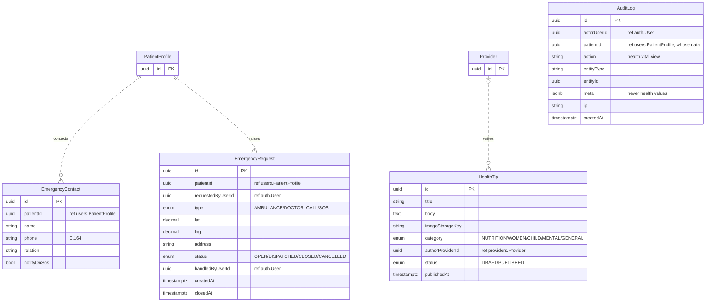

## কোর (সব মডিউলের জন্য)

- Module: `core/readable-ids`
- Schema: `core`

মানুষকে দেখানো ID-র (`PR-2611-0042`) "শেষ নম্বর + ১" রাখা হয় এখানে, প্রতিটা ধরন (PATIENT, DOCTOR, NUTRITIONIST, PHYSIO, MODERATOR, ADMIN) আর মাসের জন্য একটা সারি। `INSERT … ON CONFLICT DO UPDATE SET lastValue = lastValue + 1 RETURNING` দিয়ে একবারে বাড়ানো হয়, তাই দুজন একসাথে পেলেও নম্বর আলাদা হয়।

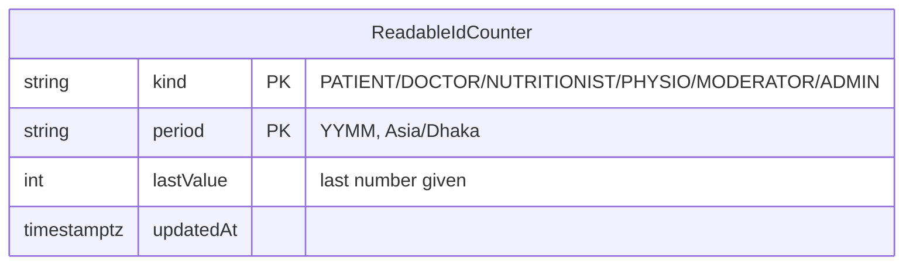

## এনক্রিপশন (সারসংক্ষেপ)

কোন কলাম এনক্রিপ্ট হয়, তা এক জায়গায়। পদ্ধতি হলো AES-256-GCM, প্রতিটা মানের জন্য নতুন IV, আর key আসে env থেকে। পরে key rotation যাতে করা যায়, তাই ciphertext-এর শুরুতে key version থাকে।

| Schema | Encrypted (`enc`) | Plain রাখা, কারণ query বা index লাগে |
|---|---|---|
| `health` | `MedicalCondition.name`, `.note`, `VitalReading.note` | ভাইটালের সংখ্যা, type, status, measuredAt |
| `records` | `MedicalFile.title` | type, reportDate, storageKey |
| `chat` | `Message.body`, `Message.attachmentStorageKey` | conversationId, createdAt, type |
| `womens_health` | বাকি সব কলাম | id, patientId, `date`/`startDate`, isPredicted, status, appLockEnabled, remindersOn, avgCycleDays, avgPeriodDays |

ফাইলগুলো নিজে (রিপোর্ট আর ছবি) প্রাইভেট স্টোরেজে থাকে। এগুলো দেখা যায় শুধু অনুমতি চেক আর মেয়াদওয়ালা লিংক (`secure_link`) দিয়ে।
